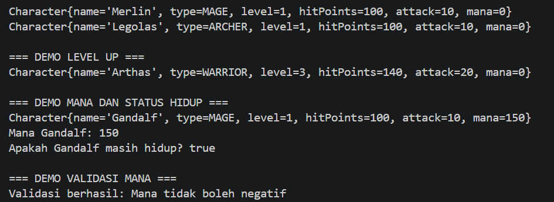
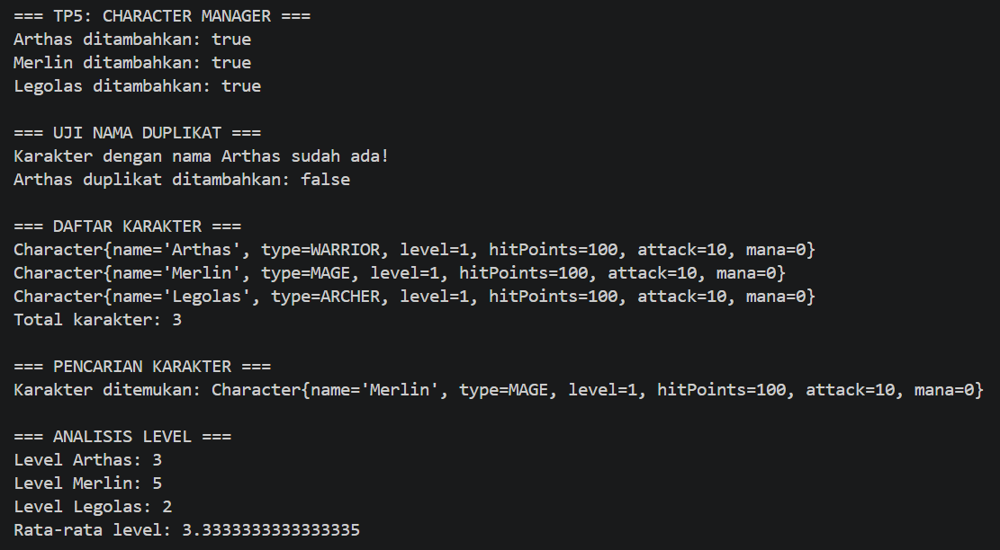
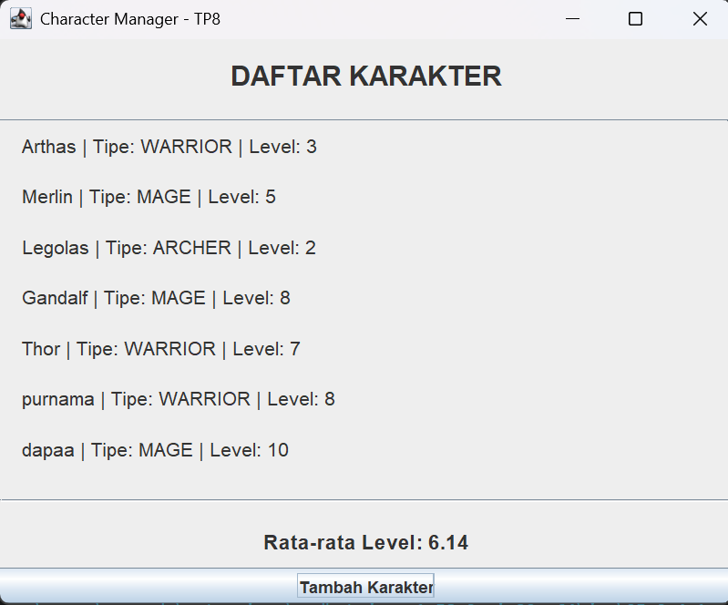
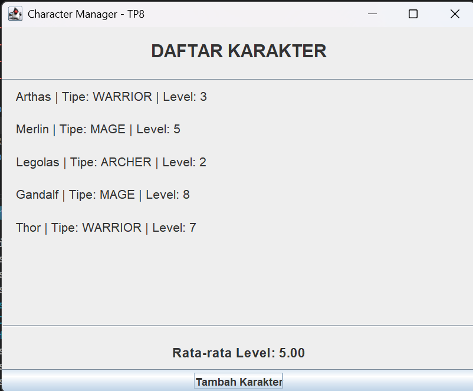
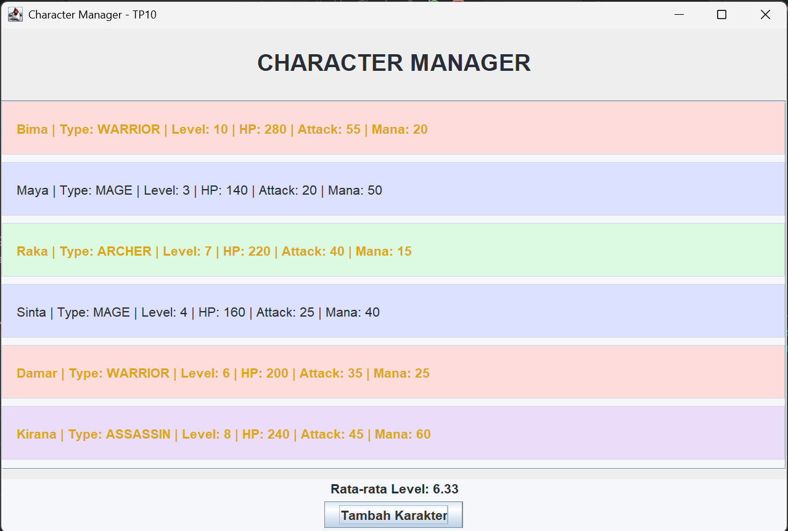

# Character Manager — TP3 (Java Visual SIH-6406)

## Deskripsi

Character Manager adalah program sederhana berbasis Java untuk membuat dan mengelola karakter permainan. Program ini menerapkan konsep class, object, constructor, encapsulation, dan enum. Program juga dilengkapi fitur tambahan berupa mana, validasi nilai mana, peningkatan level, serta pemeriksaan status hidup karakter menggunakan method `isAlive()`.

## Fitur

* Membuat karakter dengan nama dan jenis karakter.
* Menggunakan empat jenis karakter: `WARRIOR`, `MAGE`, `ARCHER`, dan `HEALER`.
* Menggunakan dua constructor pada class `Character`.
* Mengatur level, hit points, dan attack karakter.
* Menaikkan level karakter melalui method `setLevel()`.
* Menambahkan atribut `mana` bertipe `int`.
* Memvalidasi agar nilai mana tidak negatif.
* Memeriksa status hidup karakter melalui method `isAlive()`.
* Menampilkan informasi karakter menggunakan method `toString()`.

## Teknologi

* Bahasa pemrograman: Java
* JDK: 17
* Editor kode: Visual Studio Code
* Mata kuliah: Java Visual (SIH-6406)
* Tugas: TP3 — AP3 Belajar Praktik

## Struktur Folder Project

```text
CharacterManager/
├── README.md
├── screenshots/
│   └── output.png
└── src/
    └── com/
        └── unpri/
            └── charactermanager/
                ├── Main.java
                └── model/
                    ├── Character.java
                    └── CharacterType.java
```

## Screenshot Output Program

Screenshot berikut memperlihatkan hasil eksekusi program Character Manager, termasuk daftar tiga karakter, demo level up, nilai mana, hasil pemeriksaan `isAlive()`, dan validasi mana negatif.



## Identitas Mahasiswa

* **Nama lengkap:** [Purnama Sari]
* **NIM:** [253303621208]
* **Kelas:** [kelas pagi A]
* **Mata kuliah:** Java Visual (SIH-6406)

## Dokumentasi Analisis Desain

Dokumen Google Docs yang berisi analisis desain dan ekosistem Java untuk tugas TP3:

[Klik di sini untuk membuka Google Docs](https://1drv.ms/w/c/EF681E4F4E3CE288/IQAz1p2p37D5Q5d16b9GdislAadJElEDL_bpfsny-L73cIs?e=lMR1aR)

---

Character Manager Sprint #1
TP3 · AP3 Belajar Praktik
Java Visual (SIH-6406) · UNPRI


----------------

# Character Manager — TP5 AP6

## Identitas Mahasiswa

* **Nama:** [purnama sari]
* **NIM:** [253303621208]
* **Mata Kuliah:** Pemrograman Java Visual
* **Tugas:** TP5 AP6 — Character Manager Sprint #2

---

## 1. Deskripsi Proyek

Character Manager adalah program berbasis Java yang digunakan untuk mengelola data karakter game. Program ini menerapkan konsep Object-Oriented Programming (OOP), pengelolaan data menggunakan `ArrayList`, serta pencarian dan penghapusan karakter.

Pada TP5, program dikembangkan dengan menambahkan fitur pengelolaan karakter, validasi nama karakter, pencarian berdasarkan tipe, perhitungan rata-rata level, dan pencarian karakter dengan level tertinggi.

## 2. Struktur Folder

```text
CharacterManager/
├── src/
│   └── com/
│       └── unpri/
│           └── charactermanager/
│               ├── Main.java
│               ├── CharacterManager.java
│               └── model/
│                   ├── Character.java
│                   └── CharacterType.java
├── screenshots/
│   └── tp5-output.png
└── README.md
```

## 3. Fitur Program

Program Character Manager memiliki fitur berikut:

1. **Menambahkan karakter**
   Menambahkan karakter baru ke dalam daftar karakter.

2. **Validasi karakter duplikat**
   Menolak penambahan karakter dengan nama yang sudah terdaftar. Pencocokan nama dilakukan tanpa membedakan huruf besar dan kecil.

3. **Mencari karakter berdasarkan nama**
   Menemukan karakter menggunakan nama yang dimasukkan.

4. **Menghapus karakter**
   Menghapus karakter dari daftar berdasarkan nama.

5. **Menghitung jumlah karakter**
   Menampilkan jumlah karakter yang tersimpan.

6. **Mengambil salinan daftar karakter**
   Method `getAllCharacters()` mengembalikan salinan daftar sehingga perubahan pada daftar hasil salinan tidak menghapus data dari daftar utama.

7. **Menghitung rata-rata level**
   Method `getAverageLevel()` menghitung rata-rata level seluruh karakter. Jika daftar kosong, method mengembalikan nilai `0.0`.

8. **Mencari berdasarkan tipe karakter**
   Method `findByType()` mencari karakter berdasarkan tipe, seperti `WARRIOR`, `MAGE`, dan `ARCHER`.

9. **Mencari karakter dengan level tertinggi**
   Method `findStrongest()` mencari karakter dengan level paling tinggi di antara karakter yang tersimpan.

## 4. Konsep Java yang Digunakan

* **Class dan Object:** Digunakan untuk membuat dan mengelola objek karakter.
* **Encapsulation:** Data karakter dikelola melalui atribut dan method.
* **ArrayList:** Digunakan untuk menyimpan daftar karakter secara dinamis.
* **Method:** Digunakan untuk menambah, mencari, menghapus, dan menganalisis karakter.
* **equals() dan hashCode():** Digunakan untuk mendefinisikan kesetaraan objek karakter berdasarkan nama.
* **Exception Handling:** Digunakan untuk menangani kondisi kesalahan, seperti input yang tidak valid.
* **Defensive Copy:** Digunakan agar daftar internal tidak dapat diubah secara langsung melalui daftar yang dikembalikan.

## 5. Method Tambahan

Method tambahan yang dibuat adalah `findStrongest()`.

Method ini mencari karakter yang memiliki level paling tinggi dalam daftar. Dengan method tersebut, pengguna dapat mengetahui karakter dengan level tertinggi tanpa harus memeriksa setiap karakter secara manual.

Jika daftar karakter kosong, method sebaiknya mengembalikan `null` agar tidak menghasilkan kesalahan saat mencari karakter.

## 6. Hasil Pengujian Program

Pengujian dilakukan untuk memastikan seluruh fitur berjalan sesuai kebutuhan.

Pengujian meliputi:

* Menambahkan karakter Arthas, Merlin, dan Legolas.
* Mencoba menambahkan karakter dengan nama yang sudah terdaftar.
* Menampilkan seluruh karakter.
* Mencari karakter berdasarkan nama.
* Menghitung jumlah karakter.
* Menghitung rata-rata level.
* Mencari karakter berdasarkan tipe.
* Mencari karakter dengan level tertinggi.
* Memastikan perubahan pada salinan daftar tidak mengubah daftar utama.
* Menghapus karakter dari daftar.

### Screenshot Output

Simpan screenshot hasil menjalankan program di folder `screenshots` dengan nama `output_tp5_.png`.




## 7. Analisis Reference dan Object

Dalam Java, variabel bertipe objek menyimpan referensi yang menunjuk ke objek. Jika satu variabel objek diberikan kepada variabel lain, keduanya dapat menunjuk ke objek yang sama.

Contohnya:

```java
Character a = new Character("Arthas", CharacterType.WARRIOR);
Character b = a;
b.setLevel(8);
```

Pada contoh tersebut, `a` dan `b` menunjuk ke objek yang sama. Oleh karena itu, perubahan level melalui `b` juga terlihat ketika level objek diperiksa melalui `a`.

Untuk membuat objek yang benar-benar terpisah, objek baru perlu dibuat menggunakan constructor atau mekanisme penyalinan yang sesuai.

Berbeda dengan tipe data primitif seperti `int`, penyalinan referensi objek tidak membuat objek baru secara otomatis.

## 8. Kesimpulan

Melalui tugas TP5 AP6, program Character Manager dikembangkan dengan fitur pengelolaan data yang lebih lengkap. Program ini menerapkan penggunaan `ArrayList`, method pencarian dan penghapusan, validasi nama duplikat, perhitungan rata-rata level, serta pencarian karakter berdasarkan tipe dan level.

Tugas ini juga membantu memahami konsep referensi objek, kesetaraan objek menggunakan `equals()`, dan pentingnya menjaga agar data internal tidak diubah secara langsung dari luar class.

## 9. Dokumentasi Analisis

**Link Google Docs:** [https://1drv.ms/w/c/EF681E4F4E3CE288/IQA4FnerNc4XQYRnqw-o7hjPAQjro83O_OJ4Mw9Ll9GR_IA?e=yHa8Ab]


---------------------------

# Character Manager

## TP8 — MainWindow, Data Dinamis & Analisis MVC

### Identitas Mahasiswa

* **Nama:** [purnama sari]
* **NIM:** [253303621208]
* **Mata Kuliah:** Pemrograman Java Visual
* **Tugas:** TP8 AP10 — Character Manager Sprint #3

---

## 1. Deskripsi Proyek

Character Manager merupakan aplikasi berbasis Java untuk mengelola data karakter game. Pada TP8, aplikasi dikembangkan dari program berbasis console menjadi aplikasi GUI (*Graphical User Interface*) menggunakan Java Swing.

Aplikasi dapat menampilkan daftar karakter secara dinamis, menambahkan karakter baru melalui formulir, dan menghitung rata-rata level karakter secara otomatis. Pengembangan ini juga menerapkan konsep dasar MVC (*Model-View-Controller*) dengan memisahkan pengelolaan data dari tampilan aplikasi.

## 2. Struktur Folder

```text
CharacterManager/
├── src/
│   └── com/
│       └── unpri/
│           └── charactermanager/
│               ├── Main.java
│               ├── CharacterManager.java
│               ├── model/
│               │   ├── Character.java
│               │   └── CharacterType.java
│               └── view/
│                   └── MainWindow.java
├── screenshots/
│   ├── tp8-sebelum.png
│   └── tp8-sesudah.png
└── README.md
```

## 3. Fitur Aplikasi

Aplikasi Character Manager memiliki fitur berikut:

1. Menampilkan jendela utama menggunakan `JFrame`.
2. Menampilkan daftar karakter secara dinamis menggunakan perulangan.
3. Menampilkan nama, tipe, dan level setiap karakter.
4. Menambahkan karakter baru melalui tombol **Tambah Karakter**.
5. Memilih tipe karakter, seperti `WARRIOR`, `MAGE`, dan `ARCHER`.
6. Menentukan level karakter melalui formulir.
7. Menolak penambahan karakter dengan nama yang sudah terdaftar.
8. Menghitung dan menampilkan rata-rata level karakter secara otomatis.
9. Menjalankan GUI melalui `SwingUtilities.invokeLater()`.

## 4. Data Karakter

Pada TP8, aplikasi Character Manager menampilkan lima karakter awal, yaitu Arthas, Merlin, Legolas, Gandalf, dan Thor. Selain itu, saya menambahkan dua karakter baru melalui fitur Tambah Karakter pada aplikasi GUI.

Karakter tambahan tersebut adalah:

No.	Nama Karakter	Tipe	Level	Alasan Pemilihan
1	Purnama	WARRIOR	8	Dipilih sebagai karakter petarung dengan level yang cukup tinggi.
2	Dapa	MAGE	10	Dipilih sebagai karakter penyihir dengan level tertinggi di antara karakter tambahan.

Purnama dipilih sebagai karakter bertipe WARRIOR karena menggambarkan karakter yang mengandalkan kemampuan bertarung. Dapa dipilih sebagai karakter bertipe MAGE karena menggambarkan karakter yang memiliki kemampuan sihir. Kedua karakter ini digunakan untuk menguji fitur penambahan karakter melalui GUI dan memastikan data baru dapat ditampilkan secara dinamis.

## 5. Perhitungan Rata-Rata Level

Aplikasi Character Manager menghitung rata-rata level berdasarkan jumlah level seluruh karakter dibagi dengan jumlah karakter yang tersimpan.

Lima karakter awal memiliki level berikut:

Arthas: level 3
Merlin: level 5
Legolas: level 2
Gandalf: level 8
Thor: level 7

Rata-rata sebelum penambahan karakter:

(3 + 5 + 2 + 8 + 7) / 5 = 5.00

Setelah Purnama dan Dapa ditambahkan, data level menjadi:

Arthas: level 3
Merlin: level 5
Legolas: level 2
Gandalf: level 8
Thor: level 7
Purnama: level 8
Dapa: level 10

Rata-rata setelah penambahan karakter:

(3 + 5 + 2 + 8 + 7 + 8 + 10) / 7 = 6.14

Dengan demikian, rata-rata level meningkat dari 5.00 menjadi 6.14. Perubahan ini menunjukkan bahwa statistik aplikasi mengikuti jumlah dan level karakter yang tersimpan di dalam CharacterManager.

## 6. Aliran Data dan Konsep MVC

Pada aplikasi ini, `Main.java` membuat objek karakter dan memasukkannya ke dalam `CharacterManager`. Selanjutnya, `Main.java` membuat `MainWindow` dengan memberikan objek `CharacterManager` melalui constructor. `MainWindow` mengambil daftar karakter menggunakan `getAllCharacters()` dan menghitung statistik melalui `getAverageLevel()`. Ketika pengguna menambahkan karakter melalui formulir, `MainWindow` meminta `CharacterManager` menyimpan data tersebut, kemudian memperbarui daftar dan statistik.

Penerapan ini mulai memisahkan pengelolaan data dari tampilan. `CharacterManager` berperan dalam pengelolaan data, sedangkan `MainWindow` berperan sebagai View. Controller khusus belum dipisahkan menjadi class tersendiri, sehingga alur interaksi masih ditangani oleh event handler pada View.

## 7. Screenshot Hasil Program

### Sebelum Data Diubah

Screenshot pertama menunjukkan lima karakter awal dan rata-rata level sebesar 5.00.


### Sesudah Data Diubah

Screenshot kedua menunjukkan daftar karakter setelah Naruto ditambahkan dan rata-rata level berubah menjadi 6.14.



**Catatan:** Simpan screenshot asli dari aplikasi pada folder `screenshots` menggunakan nama file yang tercantum di atas. Pastikan kedua screenshot menunjukkan hasil program yang sebenarnya.

## 8. Kesimpulan

Melalui TP8, aplikasi Character Manager dikembangkan menggunakan Java Swing agar dapat menampilkan data karakter melalui GUI. Daftar karakter ditampilkan secara dinamis, pengguna dapat menambahkan karakter melalui formulir, dan statistik rata-rata level diperbarui setelah data berubah.

Tugas ini juga membantu memahami penggunaan `JFrame`, `JPanel`, `JLabel`, event-driven programming, `SwingUtilities.invokeLater()`, dan konsep dasar MVC.

## 9. Dokumentasi Analisis Google Docs

**Judul dokumen:** `JavaVisual_TP08_[purnama sari]_[253303621208]`

**Link Google Docs:** [https://1drv.ms/w/c/EF681E4F4E3CE288/IQCVjYgbhaBeRrGWPrY4-RD8ASXF7lKziWi85TCA0ig1Hl8?e=KYHsi7]

Dokumen tersebut berisi analisis mengenai program sekuensial dan event-driven, penggunaan `SwingUtilities.invokeLater()`, perbaikan kode `JFrame`, relasi *is-a* dan *has-a*, serta pembagian tanggung jawab dalam MVC.

----------------------
**#TP 10#**
# CHARACTER MANAGER SPRINT #4

## Theming, Properti Komponen & Analisis MVC

### Identitas Mahasiswa

| Keterangan  | Informasi                   |
| ----------- | --------------------------- |
| Nama        | Purnama Sari                |
| NIM         | 253303621208                |
| Kelas       | Pagi A                      |
| Mata Kuliah | Java Visual                 |
| Tugas       | TP10 / AP13                 |
| Sprint      | Character Manager Sprint #4 |

---

## 1. Deskripsi Proyek

Character Manager merupakan aplikasi berbasis Java Swing yang digunakan untuk mengelola dan menampilkan data karakter. Aplikasi ini dikembangkan secara bertahap mulai dari Sprint #1 hingga Sprint #4.

Pada Sprint #4, aplikasi dikembangkan dengan menambahkan pengaturan tema tampilan menggunakan class `AppTheme.java`. Pengaturan tersebut meliputi warna, jenis font, border, dan warna khusus berdasarkan tipe karakter.

Selain itu, aplikasi juga menerapkan beberapa properti komponen Swing agar tampilan lebih menarik, mudah dibaca, dan nyaman digunakan.

Pengembangan ini tetap mempertahankan struktur Model dari Sprint #3 agar fungsi pengelolaan data karakter tidak berubah.

## 2. Tujuan Pengembangan

Tujuan dari pengembangan Character Manager Sprint #4 adalah:

1. Menerapkan pengaturan tema aplikasi menggunakan `AppTheme.java`.
2. Menggunakan warna yang berbeda berdasarkan tipe karakter.
3. Mengatur font dan border agar tampilan lebih konsisten.
4. Menerapkan properti komponen pada Java Swing.
5. Menampilkan data karakter secara dinamis menggunakan perulangan.
6. Menerapkan konsep MVC dalam pengembangan aplikasi.
7. Mempertahankan bagian Model dari Sprint #3 tanpa perubahan.

## 3. Fitur Aplikasi

Fitur yang terdapat pada Character Manager Sprint #4:

* Menampilkan daftar karakter.
* Menampilkan nama dan tipe karakter.
* Menampilkan level, HP, dan ATK setiap karakter.
* Menggunakan warna kartu sesuai tipe karakter.
* Menampilkan karakter dengan level 5 atau lebih menggunakan tulisan berwarna emas dan tebal.
* Menampilkan informasi tambahan melalui tooltip.
* Menggunakan tampilan yang konsisten melalui AppTheme.
* Menampilkan data karakter secara dinamis menggunakan perulangan `for`.

## 4. Jenis Karakter

Aplikasi memiliki empat jenis karakter, yaitu:

| Tipe Karakter | Warna Tampilan | Keterangan                                                  |
| ------------- | -------------- | ----------------------------------------------------------- |
| WARRIOR       | Merah          | Karakter petarung jarak dekat dengan HP tinggi.             |
| MAGE          | Biru           | Karakter yang menggunakan serangan sihir.                   |
| ARCHER        | Hijau          | Karakter yang menyerang dari jarak jauh.                    |
| ASSASSIN      | Abu-abu        | Karakter dengan tipe khusus yang menggunakan warna default. |

Warna karakter diatur melalui method `colorFor()` pada class `AppTheme.java`.

## 5. Data Karakter

Aplikasi menampilkan enam karakter dengan tipe dan level yang berbeda.

| No. | Nama   | Tipe     | Level | Mana |
| --- | ------ | -------- | ----- | ---- |
| 1   | Bima   | WARRIOR  | 10    | 20   |
| 2   | Maya   | MAGE     | 3     | 50   |
| 3   | Raka   | ARCHER   | 7     | 15   |
| 4   | Sinta  | MAGE     | 4     | 40   |
| 5   | Damar  | WARRIOR  | 6     | 25   |
| 6   | Kirana | ASSASSIN | 8     | 60   |

Karakter dengan level 5 atau lebih ditampilkan menggunakan tulisan berwarna emas dan tebal. Dengan demikian, pengguna dapat membedakan karakter berdasarkan levelnya.

## 6. Struktur Folder Proyek

Struktur folder proyek Character Manager adalah sebagai berikut:

CharacterManager/
│
├── src/
│   └── com/
│       └── unpri/
│           └── charactermanager/
│               │
│               ├── Main.java
│               │
│               ├── model/
│               │   ├── Character.java
│               │   ├── CharacterManager.java
│               │   └── CharacterType.java
│               │
│               └── view/
│                   ├── AppTheme.java
│                   └── MainWindow.java
│
├── Screenshot/
│   ├── output_tp8.png
│   └── output_tp10.png
│
└── README.md

### Penjelasan File

**1. Main.java**

Merupakan file utama untuk menjalankan aplikasi. File ini membuat objek karakter, memasukkan karakter ke dalam CharacterManager, dan membuka tampilan MainWindow menggunakan `SwingUtilities.invokeLater()`.

**2. Character.java**

Merupakan class Model yang menyimpan data karakter, seperti nama, tipe, level, HP, attack, dan mana.

**3. CharacterManager.java**

Digunakan untuk mengelola kumpulan karakter, seperti menambahkan karakter, mencari karakter, menghapus karakter, dan menghitung jumlah karakter.

**4. CharacterType.java**

Merupakan enum yang berisi empat tipe karakter, yaitu WARRIOR, MAGE, ARCHER, dan ASSASSIN.

**5. AppTheme.java**

Merupakan pusat pengaturan tema aplikasi yang berisi warna, font, border, serta pengaturan warna berdasarkan tipe karakter.

**6. MainWindow.java**

Merupakan bagian tampilan aplikasi yang menggunakan Java Swing. File ini menampilkan daftar karakter secara dinamis dan menerapkan pengaturan tema dari AppTheme.

## 7. Implementasi AppTheme

Pada Sprint #4 dibuat class `AppTheme.java` sebagai pusat pengaturan tampilan aplikasi.

Pengaturan yang diterapkan meliputi:

### A. Pengaturan Warna

AppTheme memiliki beberapa warna, seperti:

* `BG_MAIN` untuk warna latar belakang utama.
* `TEXT_MAIN` untuk warna teks utama.
* `TEXT_LIGHT` untuk warna teks terang.
* `GOLD` untuk teks karakter dengan level tinggi.

Selain itu, terdapat method `colorFor()` untuk menentukan warna kartu berdasarkan tipe karakter.

### B. Pengaturan Font

AppTheme menyediakan tiga jenis font:

* `FONT_TITLE` untuk judul aplikasi.
* `FONT_BODY` untuk teks informasi karakter.
* `FONT_MONO` untuk teks dengan jenis font Monospaced.

### C. Pengaturan Border

`CARD_BORDER` digunakan untuk memberikan jarak di dalam kartu karakter agar informasi tidak terlalu dekat dengan tepi komponen.

Dengan adanya AppTheme, pengaturan tampilan aplikasi menjadi lebih terpusat dan mudah diubah.

## 8. Properti Tambahan Komponen Swing

Pada pengembangan Sprint #4, terdapat beberapa properti tambahan yang diterapkan pada komponen Swing.

### A. ToolTipText

Properti `setToolTipText()` digunakan untuk menampilkan informasi tambahan ketika pengguna mengarahkan kursor ke kartu karakter.

Informasi yang ditampilkan berupa deskripsi tipe karakter serta informasi HP dan ATK.

**Alasan penggunaan:** Membantu pengguna mendapatkan informasi tambahan tanpa membuat tampilan utama terlalu penuh.

### B. Cursor

Properti `setCursor()` digunakan untuk mengubah bentuk kursor ketika diarahkan ke kartu karakter.

Kursor menggunakan bentuk `HAND_CURSOR`.

**Alasan penggunaan:** Memberikan petunjuk visual bahwa komponen dapat diarahkan atau berinteraksi dengan pengguna.

### C. Opaque

Properti `setOpaque(true)` diterapkan pada JLabel kartu karakter agar warna background dapat ditampilkan dengan benar.

**Alasan penggunaan:** Memastikan warna kartu karakter terlihat sesuai dengan warna yang ditentukan di AppTheme.

## 9. Penerapan Level Tinggi

Aplikasi menerapkan ketentuan bahwa karakter dengan level minimal 5 akan mendapatkan tampilan khusus.

Pengaturan tersebut menggunakan konstanta `HIGH_LEVEL_THRESHOLD` dengan nilai 5.

Karakter yang memenuhi ketentuan akan memiliki:

* Warna teks emas.
* Font tebal atau bold.

Penggunaan konstanta bertujuan agar batas level mudah diubah tanpa harus mengedit banyak bagian kode.

## 10. Analisis MVC

Pengembangan Character Manager menggunakan konsep MVC (Model-View-Controller).

### A. Model

Model merupakan bagian yang bertanggung jawab mengelola data dan logika aplikasi.

File yang termasuk bagian Model:

* Character.java
* CharacterManager.java
* CharacterType.java

### B. View

View merupakan bagian yang bertanggung jawab menampilkan informasi kepada pengguna.

File yang termasuk bagian View:

* MainWindow.java
* AppTheme.java

MainWindow menampilkan daftar karakter, sedangkan AppTheme mengatur warna, font, dan tampilan komponen.

### C. Controller

Pada implementasi ini, alur awal aplikasi diatur melalui Main.java. File tersebut membuat data karakter, memasukkannya ke CharacterManager, kemudian meneruskan data ke MainWindow untuk ditampilkan.

Dengan pemisahan tanggung jawab tersebut, pengelolaan data dan tampilan aplikasi menjadi lebih terstruktur.

## 11. Screenshot Hasil Aplikasi

### A. Tampilan Sebelum Pengembangan (TP8 / v0.3)

Screenshot berikut menunjukkan tampilan aplikasi sebelum penerapan tema Sprint #4.



### B. Tampilan Setelah Pengembangan (TP10 / v0.4)

Screenshot berikut menunjukkan tampilan aplikasi setelah penerapan AppTheme, warna kartu berdasarkan tipe karakter, font, dan properti tambahan komponen Swing.



## 12. Alasan Penggunaan AppTheme

Pengaturan warna dan font diletakkan di dalam AppTheme, bukan di dalam Character.java, karena Character.java merupakan bagian Model yang bertugas menyimpan dan mengelola data karakter.

Jika pengaturan tampilan dimasukkan ke dalam Model, maka tanggung jawab antara data dan tampilan akan tercampur. Hal ini dapat membuat kode sulit dipelihara dan menyulitkan perubahan tampilan aplikasi.

Dengan menggunakan AppTheme, pengaturan warna, font, dan border menjadi lebih terpusat sehingga lebih mudah dikelola.

## 13. Cara Menjalankan Aplikasi

Langkah menjalankan aplikasi:

1. Buka folder CharacterManager menggunakan Visual Studio Code.
2. Pastikan seluruh file Java berada pada package yang sesuai.
3. Pastikan Java Development Kit (JDK) sudah terpasang.
4. Buka file `Main.java`.
5. Jalankan program menggunakan tombol Run Java.
6. Aplikasi Character Manager akan menampilkan daftar enam karakter.

## 14. Link Google Docs Analisis MVC

Dokumen analisis MVC dan properti komponen Swing dibuat secara terpisah menggunakan Google Docs.

**Link Google Docs:**
(https://1drv.ms/w/c/EF681E4F4E3CE288/IQAcJDuXdPxjT77TTgSWo8igAe5r36mWLeHtZBQ6tiCMnIs?e=RXezku)

Dokumen tersebut membahas:

1. Getter dan setter pada komponen Swing.
2. Penggunaan setForeground dan setBackground.
3. Perbedaan setSize, setPreferredSize, dan pack.
4. Alasan pengaturan warna berada di AppTheme.
5. Logical Font dan penggunaan deriveFont.

## 15. Kesimpulan

Berdasarkan pengembangan Character Manager Sprint #4, aplikasi telah menerapkan pengaturan tema menggunakan AppTheme, pengaturan warna berdasarkan tipe karakter, penggunaan font, border, dan properti tambahan komponen Swing.

Aplikasi juga menampilkan data enam karakter secara dinamis dan memberikan tampilan khusus untuk karakter dengan level minimal 5.

Melalui pengembangan ini, pemahaman mengenai Java Swing, properti komponen, pengaturan tampilan, dan konsep MVC menjadi lebih baik. Struktur Model dari Sprint #3 tetap dipertahankan sehingga pengembangan Sprint #4 dapat melanjutkan pekerjaan sebelumnya.


