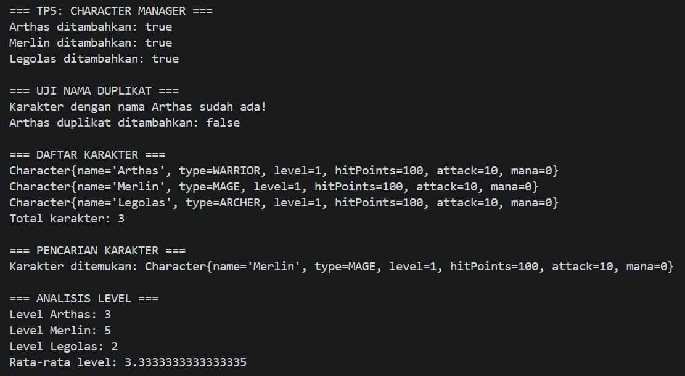

# Character Manager — TP3 (Java Visual SIH-6406)

## Deskripsi

Character Manager adalah program sederhana berbasis Java untuk membuat dan mengelola karakter permainan. Program ini menerapkan konsep class, object, constructor, encapsulation, dan enum. Program juga dilengkapi fitur tambahan berupa mana, validasi nilai mana, peningkatan level, serta pemeriksaan status hidup karakter menggunakan method `isAlive()`.

## Fitur

* Membuat karakter dengan nama dan jenis karakter.
* Menggunakan empat jenis karakter: `WARRIOR`, `MAGE`, `ARCHER`, dan `HEALER`.
* Menggunakan dua constructor pada class `Character`.
* Mengatur level, hit points, dan attack karakter.
* Menaikkan level karakter melalui method `setLevel()`.
* Menambahkan atribut `mana` bertipe `int`.
* Memvalidasi agar nilai mana tidak negatif.
* Memeriksa status hidup karakter melalui method `isAlive()`.
* Menampilkan informasi karakter menggunakan method `toString()`.

## Teknologi

* Bahasa pemrograman: Java
* JDK: 17
* Editor kode: Visual Studio Code
* Mata kuliah: Java Visual (SIH-6406)
* Tugas: TP3 — AP3 Belajar Praktik

## Struktur Folder Project

```text
CharacterManager/
├── README.md
├── screenshots/
│   └── output.png
└── src/
    └── com/
        └── unpri/
            └── charactermanager/
                ├── Main.java
                └── model/
                    ├── Character.java
                    └── CharacterType.java
```

## Screenshot Output Program

Screenshot berikut memperlihatkan hasil eksekusi program Character Manager, termasuk daftar tiga karakter, demo level up, nilai mana, hasil pemeriksaan `isAlive()`, dan validasi mana negatif.


## Identitas Mahasiswa

* **Nama lengkap:** [Purnama Sari]
* **NIM:** [253303621208]
* **Kelas:** [kelas pagi A]
* **Mata kuliah:** Java Visual (SIH-6406)

## Dokumentasi Analisis Desain

Dokumen Google Docs yang berisi analisis desain dan ekosistem Java untuk tugas TP3:

[Klik di sini untuk membuka Google Docs](https://1drv.ms/w/c/EF681E4F4E3CE288/IQAz1p2p37D5Q5d16b9GdislAadJElEDL_bpfsny-L73cIs?e=lMR1aR)

---

Character Manager Sprint #1
TP3 · AP3 Belajar Praktik
Java Visual (SIH-6406) · UNPRI


----------------

# Character Manager — TP5 AP6

## Identitas Mahasiswa

* **Nama:** [purnama sari]
* **NIM:** [253303621208]
* **Mata Kuliah:** Pemrograman Java Visual
* **Tugas:** TP5 AP6 — Character Manager Sprint #2

---

## 1. Deskripsi Proyek

Character Manager adalah program berbasis Java yang digunakan untuk mengelola data karakter game. Program ini menerapkan konsep Object-Oriented Programming (OOP), pengelolaan data menggunakan `ArrayList`, serta pencarian dan penghapusan karakter.

Pada TP5, program dikembangkan dengan menambahkan fitur pengelolaan karakter, validasi nama karakter, pencarian berdasarkan tipe, perhitungan rata-rata level, dan pencarian karakter dengan level tertinggi.

## 2. Struktur Folder

```text
CharacterManager/
├── src/
│   └── com/
│       └── unpri/
│           └── charactermanager/
│               ├── Main.java
│               ├── CharacterManager.java
│               └── model/
│                   ├── Character.java
│                   └── CharacterType.java
├── screenshots/
│   └── tp5-output.png
└── README.md
```

## 3. Fitur Program

Program Character Manager memiliki fitur berikut:

1. **Menambahkan karakter**
   Menambahkan karakter baru ke dalam daftar karakter.

2. **Validasi karakter duplikat**
   Menolak penambahan karakter dengan nama yang sudah terdaftar. Pencocokan nama dilakukan tanpa membedakan huruf besar dan kecil.

3. **Mencari karakter berdasarkan nama**
   Menemukan karakter menggunakan nama yang dimasukkan.

4. **Menghapus karakter**
   Menghapus karakter dari daftar berdasarkan nama.

5. **Menghitung jumlah karakter**
   Menampilkan jumlah karakter yang tersimpan.

6. **Mengambil salinan daftar karakter**
   Method `getAllCharacters()` mengembalikan salinan daftar sehingga perubahan pada daftar hasil salinan tidak menghapus data dari daftar utama.

7. **Menghitung rata-rata level**
   Method `getAverageLevel()` menghitung rata-rata level seluruh karakter. Jika daftar kosong, method mengembalikan nilai `0.0`.

8. **Mencari berdasarkan tipe karakter**
   Method `findByType()` mencari karakter berdasarkan tipe, seperti `WARRIOR`, `MAGE`, dan `ARCHER`.

9. **Mencari karakter dengan level tertinggi**
   Method `findStrongest()` mencari karakter dengan level paling tinggi di antara karakter yang tersimpan.

## 4. Konsep Java yang Digunakan

* **Class dan Object:** Digunakan untuk membuat dan mengelola objek karakter.
* **Encapsulation:** Data karakter dikelola melalui atribut dan method.
* **ArrayList:** Digunakan untuk menyimpan daftar karakter secara dinamis.
* **Method:** Digunakan untuk menambah, mencari, menghapus, dan menganalisis karakter.
* **equals() dan hashCode():** Digunakan untuk mendefinisikan kesetaraan objek karakter berdasarkan nama.
* **Exception Handling:** Digunakan untuk menangani kondisi kesalahan, seperti input yang tidak valid.
* **Defensive Copy:** Digunakan agar daftar internal tidak dapat diubah secara langsung melalui daftar yang dikembalikan.

## 5. Method Tambahan

Method tambahan yang dibuat adalah `findStrongest()`.

Method ini mencari karakter yang memiliki level paling tinggi dalam daftar. Dengan method tersebut, pengguna dapat mengetahui karakter dengan level tertinggi tanpa harus memeriksa setiap karakter secara manual.

Jika daftar karakter kosong, method sebaiknya mengembalikan `null` agar tidak menghasilkan kesalahan saat mencari karakter.

## 6. Hasil Pengujian Program

Pengujian dilakukan untuk memastikan seluruh fitur berjalan sesuai kebutuhan.

Pengujian meliputi:

* Menambahkan karakter Arthas, Merlin, dan Legolas.
* Mencoba menambahkan karakter dengan nama yang sudah terdaftar.
* Menampilkan seluruh karakter.
* Mencari karakter berdasarkan nama.
* Menghitung jumlah karakter.
* Menghitung rata-rata level.
* Mencari karakter berdasarkan tipe.
* Mencari karakter dengan level tertinggi.
* Memastikan perubahan pada salinan daftar tidak mengubah daftar utama.
* Menghapus karakter dari daftar.

### Screenshot Output

Simpan screenshot hasil menjalankan program di folder `screenshots` dengan nama `output_tp5_.png`.




## 7. Analisis Reference dan Object

Dalam Java, variabel bertipe objek menyimpan referensi yang menunjuk ke objek. Jika satu variabel objek diberikan kepada variabel lain, keduanya dapat menunjuk ke objek yang sama.

Contohnya:

```java
Character a = new Character("Arthas", CharacterType.WARRIOR);
Character b = a;
b.setLevel(8);
```

Pada contoh tersebut, `a` dan `b` menunjuk ke objek yang sama. Oleh karena itu, perubahan level melalui `b` juga terlihat ketika level objek diperiksa melalui `a`.

Untuk membuat objek yang benar-benar terpisah, objek baru perlu dibuat menggunakan constructor atau mekanisme penyalinan yang sesuai.

Berbeda dengan tipe data primitif seperti `int`, penyalinan referensi objek tidak membuat objek baru secara otomatis.

## 8. Kesimpulan

Melalui tugas TP5 AP6, program Character Manager dikembangkan dengan fitur pengelolaan data yang lebih lengkap. Program ini menerapkan penggunaan `ArrayList`, method pencarian dan penghapusan, validasi nama duplikat, perhitungan rata-rata level, serta pencarian karakter berdasarkan tipe dan level.

Tugas ini juga membantu memahami konsep referensi objek, kesetaraan objek menggunakan `equals()`, dan pentingnya menjaga agar data internal tidak diubah secara langsung dari luar class.

## 9. Dokumentasi Analisis

**Link Google Docs:** [https://1drv.ms/w/c/EF681E4F4E3CE288/IQA4FnerNc4XQYRnqw-o7hjPAQjro83O_OJ4Mw9Ll9GR_IA?e=yHa8Ab]

