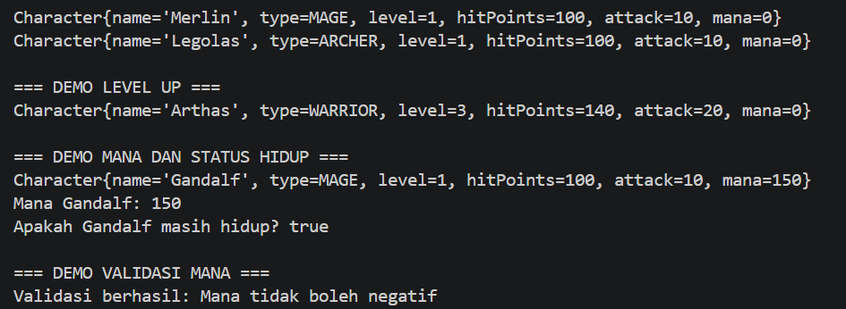

# Character Manager — TP3 (Java Visual SIH-6406)

## Deskripsi

Character Manager adalah program sederhana berbasis Java untuk membuat dan mengelola karakter permainan. Program ini menerapkan konsep class, object, constructor, encapsulation, dan enum. Program juga dilengkapi fitur tambahan berupa mana, validasi nilai mana, peningkatan level, serta pemeriksaan status hidup karakter menggunakan method `isAlive()`.

## Fitur

* Membuat karakter dengan nama dan jenis karakter.
* Menggunakan empat jenis karakter: `WARRIOR`, `MAGE`, `ARCHER`, dan `HEALER`.
* Menggunakan dua constructor pada class `Character`.
* Mengatur level, hit points, dan attack karakter.
* Menaikkan level karakter melalui method `setLevel()`.
* Menambahkan atribut `mana` bertipe `int`.
* Memvalidasi agar nilai mana tidak negatif.
* Memeriksa status hidup karakter melalui method `isAlive()`.
* Menampilkan informasi karakter menggunakan method `toString()`.

## Teknologi

* Bahasa pemrograman: Java
* JDK: 17
* Editor kode: Visual Studio Code
* Mata kuliah: Java Visual (SIH-6406)
* Tugas: TP3 — AP3 Belajar Praktik

## Struktur Folder Project

```text
CharacterManager/
├── README.md
├── screenshots/
│   └── output.png
└── src/
    └── com/
        └── unpri/
            └── charactermanager/
                ├── Main.java
                └── model/
                    ├── Character.java
                    └── CharacterType.java
```

## Screenshot Output Program

Screenshot berikut memperlihatkan hasil eksekusi program Character Manager, termasuk daftar tiga karakter, demo level up, nilai mana, hasil pemeriksaan `isAlive()`, dan validasi mana negatif.



## Identitas Mahasiswa

* **Nama lengkap:** [Purnama Sari]
* **NIM:** [253303621208]
* **Kelas:** [kelas pagi A]
* **Mata kuliah:** Java Visual (SIH-6406)

## Dokumentasi Analisis Desain

Dokumen Google Docs yang berisi analisis desain dan ekosistem Java untuk tugas TP3:

[Klik di sini untuk membuka Google Docs](https://1drv.ms/w/c/EF681E4F4E3CE288/IQAz1p2p37D5Q5d16b9GdislAadJElEDL_bpfsny-L73cIs?e=lMR1aR)

---

Character Manager Sprint #1
TP3 · AP3 Belajar Praktik
Java Visual (SIH-6406) · UNPRI
