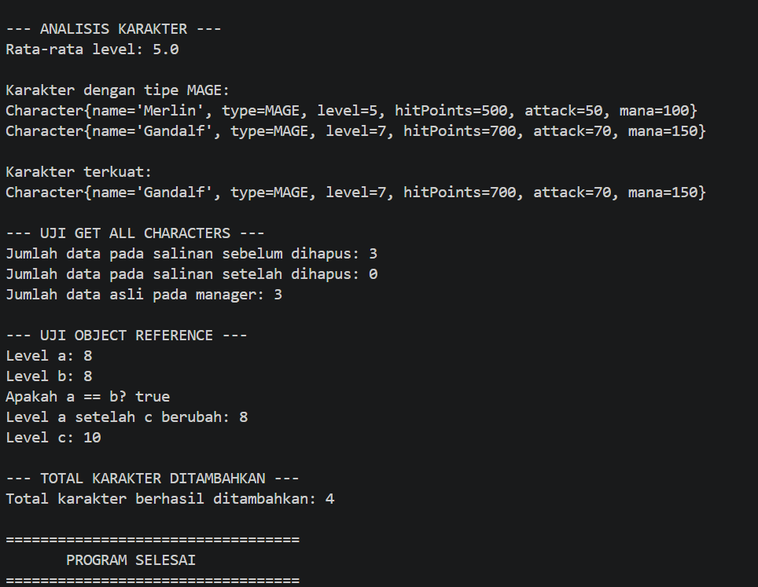
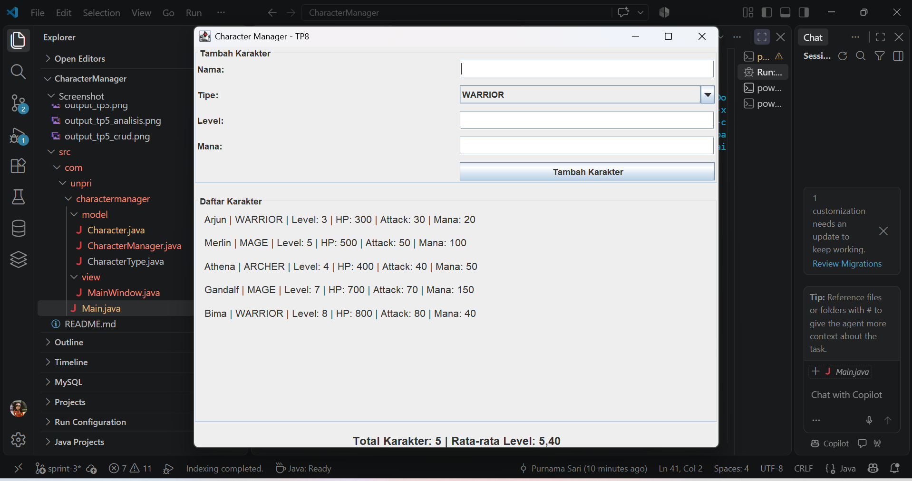
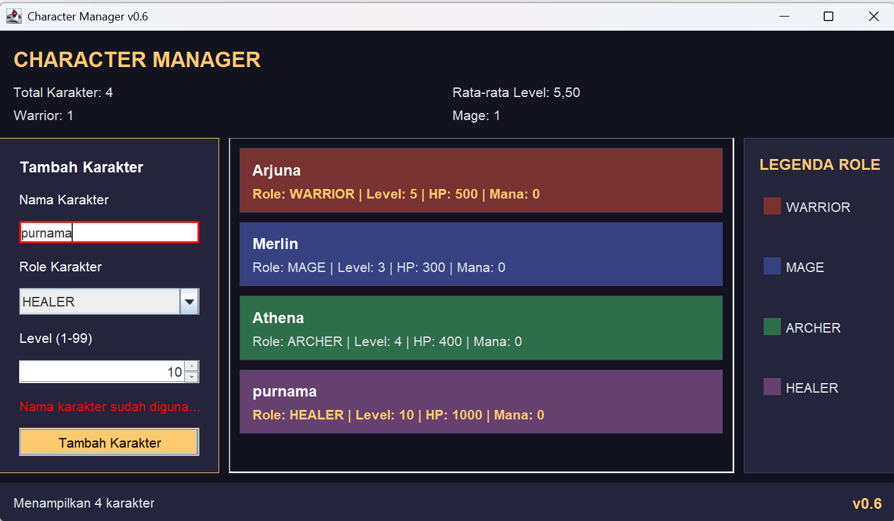
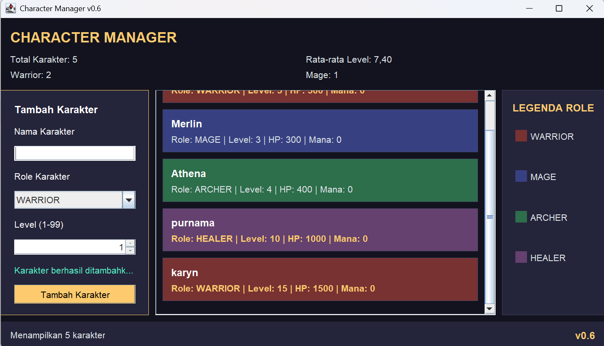

# Character Manager — TP3 (Java Visual SIH-6406)

## 1. Deskripsi Project

Character Manager merupakan aplikasi sederhana berbasis Java yang dikembangkan untuk memenuhi tugas TP3 (AP3 Belajar Praktik) mata kuliah Java Visual SIH-6406.

Project ini menerapkan konsep dasar Object-Oriented Programming (OOP), meliputi Class, Object, Attribute, Constructor, Method, dan Encapsulation. Program digunakan untuk membuat, mengatur, serta menampilkan informasi karakter berdasarkan tipe dan atribut yang dimiliki.

## 2. Fitur Program

Fitur yang telah dikembangkan dalam TP3:

- Membuat class `Character` sebagai representasi objek karakter.
- Menggunakan enum `CharacterType` untuk menentukan jenis karakter.
- Membuat objek menggunakan dua constructor.
- Mengatur atribut karakter seperti nama, level, hit points, attack, dan mana.
- Menggunakan getter dan setter untuk mengakses atribut.
- Menerapkan validasi pada atribut mana.
- Menggunakan method `toString()` untuk menampilkan informasi karakter.
- Menggunakan method `isAlive()` untuk mengetahui apakah karakter masih hidup berdasarkan hit points.
- Menampilkan tiga karakter dan demonstrasi level up melalui terminal.

## 3. Screenshot Hasil Program

Berikut merupakan dokumentasi hasil pengujian program Character Manager TP3 melalui terminal Visual Studio Code.

### Output Terminal

![Screenshot Output TP3] 

Screenshot tersebut memperlihatkan hasil program ketika dijalankan, termasuk informasi karakter, demonstrasi level up, dan hasil pengujian method `isAlive()`.

## 4. Struktur Folder Project

Berikut adalah struktur folder project Character Manager:

```text
CharacterManager/
│
├── src/
│   └── com/
│       └── unpri/
│           └── charactermanager/
│               ├── Main.java
│               │
│               └── model/
│                   ├── Character.java
│                   └── CharacterType.java
│
├── Screenshot/
│   └── output_tp3.png
│
└── README.md
```

## 5. Teknologi yang Digunakan

| Teknologi | Keterangan |
|---|---|
| Java JDK 17 | Bahasa pemrograman dan development kit |
| Visual Studio Code | Code editor |
| Git | Version control |
| GitHub | Penyimpanan repository |

## 6. Identitas Mahasiswa

| Keterangan | Informasi |
|---|---|
| Nama | Purnama Sari |
| NIM | 253303621208 |
| Mata Kuliah | Java Visual SIH-6406 |
| Tugas | TP3 – Character Manager Sprint #1 |

## 7. Link Dokumentasi Google Docs

Dokumentasi analisis desain dan ekosistem Java untuk memenuhi Bagian D tugas TP3 dapat diakses melalui tautan berikut:

**Google Docs:** [https://1drv.ms/w/c/EF681E4F4E3CE288/IQAz1p2p37D5Q5d16b9GdislAadJElEDL_bpfsny-L73cIs?e=xOdoln]

## 8. Kesimpulan

Melalui tugas TP3 Character Manager, saya mempelajari penerapan konsep dasar Object-Oriented Programming menggunakan bahasa Java. Saya memahami cara membuat class, object, constructor, attribute, dan method untuk membangun program pengelolaan karakter sederhana.

Selain itu, saya juga mempelajari penerapan encapsulation, penggunaan enum, validasi data, serta pengembangan method tambahan seperti `isAlive()`.

Project ini menjadi dasar pengembangan Character Manager pada sprint berikutnya.


--------------------------------------
# TP5 – Character Manager Sprint #2

## CharacterManager, Analytics & Object Reference

### Deskripsi
Pada TP5, proyek Character Manager dikembangkan dengan menambahkan kelas CharacterManager untuk mengelola data karakter. Program dilengkapi fitur penambahan, pencarian, penghapusan, dan perhitungan jumlah karakter.

Selain itu, program menerapkan konsep Object Reference, penggunaan ArrayList, serta analisis data karakter.

### Fitur yang Dikembangkan
1. `addCharacter()` – Menambahkan karakter dan menolak nama duplikat.
2. `findByName()` – Mencari karakter berdasarkan nama.
3. `removeCharacter()` – Menghapus karakter.
4. `getTotalCharacters()` – Menghitung jumlah karakter.
5. `getAllCharacters()` – Mengembalikan salinan daftar karakter.
6. `getAverageLevel()` – Menghitung rata-rata level karakter.
7. `findByType()` – Mencari karakter berdasarkan jenis.
8. `findStrongest()` – Mencari karakter dengan attack tertinggi.
9. `equals()` – Membandingkan karakter berdasarkan nama.

### Pengujian Program
Program diuji melalui beberapa percobaan:
- Penambahan karakter.
- Penolakan karakter duplikat.
- Pencarian dan penghapusan karakter.
- Perhitungan rata-rata level.
- Pencarian berdasarkan tipe karakter.
- Pencarian karakter terkuat.
- Pengujian salinan ArrayList.
- Pengujian Object Reference.

### Screenshot Hasil Program

**1. Pengujian CRUD dan Duplikat**


**2. Pengujian Analisis Karakter**


### Identitas
- Nama: Purnama Sari
- NIM: 253303621208
- Mata Kuliah: Java Visual
- Tugas: TP5 / AP6
- Sprint: 2

### Link Google Docs

Dokumentasi analisis TP5 yang berisi pembahasan Object Reference, Primitive vs Reference, Static Variable, penggunaan equals(), dan Encapsulation.

Google Docs: [https://1drv.ms/w/c/EF681E4F4E3CE288/IQA4FnerNc4XQYRnqw-o7hjPAQjro83O_OJ4Mw9Ll9GR_IA?e=xlnIAI]

### Analisis Metode Tambahan
Metode `findStrongest()` digunakan untuk mencari karakter dengan nilai attack tertinggi. Metode ini membantu mengetahui karakter yang memiliki kekuatan serangan paling besar tanpa memberikan akses langsung ke ArrayList internal milik CharacterManager.

### Kesimpulan
Melalui TP5, proyek Character Manager memiliki kemampuan pengelolaan data yang lebih lengkap. Saya juga memahami konsep encapsulation, object reference, static, equals(), dan penggunaan ArrayList dalam Java.

------------------------------------------------------

# CHARACTER MANAGER – TP8 (SPRINT 3)

## 1. Informasi Mahasiswa

- **Nama:** Purnama Sari
- **NIM:** 253303621208
- **Mata Kuliah:** Java Visual
- **Kode Mata Kuliah:** SIH-6406
- **Tugas:** TP8 – AP10
- **Sprint:** Sprint 3 – MainWindow, Data Dinamis & Analisis MVC

---

## 2. Deskripsi Proyek

Character Manager merupakan aplikasi berbasis Java yang digunakan untuk mengelola data karakter. Pada TP8 atau Sprint 3, aplikasi dikembangkan dari program berbasis console menjadi aplikasi berbasis Graphical User Interface (GUI) menggunakan Java Swing.

Aplikasi ini memungkinkan pengguna melihat daftar karakter, menambahkan karakter baru melalui formulir GUI, serta melihat statistik jumlah karakter dan rata-rata level secara otomatis.

Pengembangan ini juga menerapkan konsep Model-View-Controller (MVC) untuk memisahkan pengelolaan data dengan tampilan aplikasi.

## 3. Fitur Aplikasi

Fitur yang tersedia pada TP8:

1. Menampilkan daftar karakter secara dinamis.
2. Menambahkan karakter melalui formulir GUI.
3. Memilih tipe karakter melalui ComboBox.
4. Mengisi nama, level, dan mana karakter.
5. Menolak nama karakter yang sudah digunakan.
6. Melakukan validasi input.
7. Menampilkan total karakter.
8. Menghitung rata-rata level karakter secara otomatis.
9. Memperbarui tampilan setelah karakter berhasil ditambahkan.

## 4. Struktur Folder Proyek

```text
CharacterManager/
│
├── src/
│   └── com/
│       └── unpri/
│           └── charactermanager/
│               ├── Main.java
│               │
│               ├── model/
│               │   ├── Character.java
│               │   ├── CharacterType.java
│               │   └── CharacterManager.java
│               │
│               └── view/
│                   └── MainWindow.java
│
├── Screenshot/
│   ├── tp8_sebelum.png
│   └── tp8_sesudah.png
│
└── README.md
```

## 5. Data Karakter

Aplikasi memiliki lima karakter awal yang ditampilkan ketika program dijalankan:

| No. | Nama | Tipe | Level |
|---|---|---|---|
| 1 | Arjun | WARRIOR | 3 |
| 2 | Merlin | MAGE | 5 |
| 3 | Athena | ARCHER | 4 |
| 4 | Gandalf | MAGE | 7 |
| 5 | Bima | WARRIOR | 8 |

Pengguna juga dapat menambahkan karakter baru secara langsung melalui formulir pada jendela aplikasi.

## 6. Penerapan Konsep MVC

Aplikasi menggunakan konsep Model-View-Controller (MVC).

- **Model:** terdiri dari Character, CharacterType, dan CharacterManager yang bertugas menyimpan serta mengelola data karakter.
- **View:** MainWindow.java bertugas menampilkan data karakter dan menyediakan formulir untuk memasukkan karakter baru.
- **Alur data:** Main.java membuat objek CharacterManager dan memasukkan data awal, kemudian MainWindow menerima pengelola data tersebut untuk menampilkan karakter.

Dengan pemisahan ini, pengelolaan data dan tampilan aplikasi menjadi lebih terstruktur.

## 7. Alur Penggunaan Aplikasi

1. Program dijalankan melalui Main.java.
2. CharacterManager dibuat dan diisi dengan lima karakter awal.
3. MainWindow menampilkan jendela aplikasi.
4. Pengguna mengisi nama, tipe, level, dan mana karakter.
5. Pengguna menekan tombol Tambah Karakter.
6. Program memvalidasi data yang dimasukkan.
7. Jika berhasil, karakter ditambahkan dan daftar diperbarui.
8. Total karakter dan rata-rata level dihitung kembali.

## 8. Screenshot Hasil Program

### Sebelum Menambahkan Karakter

Menampilkan lima karakter awal beserta statistik rata-rata level.

![Screenshot Sebelum]

### Sesudah Menambahkan Karakter

Menampilkan karakter tambahan yang dimasukkan melalui GUI serta perubahan statistik rata-rata level.

![Screenshot Sesudah]

## 9. Dokumentasi Google Docs

**Link Google Docs Analisis TP8:**

[https://1drv.ms/w/c/EF681E4F4E3CE288/IQCVjYgbhaBeRrGWPrY4-RD8ASXF7lKziWi85TCA0ig1Hl8?e=bMIEth]

Dokumen berisi penjelasan mengenai konsep sequential dan event-driven programming, SwingUtilities.invokeLater(), inheritance, composition, serta penerapan konsep MVC pada aplikasi Character Manager.

## 10. Kesimpulan

Melalui TP8 Sprint 3, aplikasi Character Manager berhasil dikembangkan menjadi aplikasi GUI menggunakan Java Swing. Pengguna dapat melihat dan menambahkan data karakter secara langsung melalui jendela aplikasi. Selain itu, penerapan konsep MVC membantu memisahkan pengelolaan data dan tampilan sehingga program lebih terstruktur dan mudah dikembangkan.


-----------------------------------------------------------

# TP10 — Character Manager Sprint #4
## Theming, Properti Komponen & Analisis MVC

### A. Implementasi Tema

Pada TP10, aplikasi Character Manager dikembangkan menggunakan sistem tema terpusat melalui kelas `AppTheme.java`.

`AppTheme` digunakan untuk mengatur warna, font, border, dan warna kartu berdasarkan role karakter. Dengan demikian, pengaturan tampilan tidak perlu ditulis berulang kali di `MainWindow.java`.

Implementasi yang dibuat meliputi:
- Warna latar utama aplikasi.
- Warna kartu karakter berdasarkan role.
- Font judul, subtitle, dan isi.
- Border kartu karakter.
- Method `colorFor()` untuk menentukan warna berdasarkan tipe karakter.
- `pack()` untuk menyesuaikan ukuran jendela.

### B. Mini-Challenge

Karakter dengan level minimal 5 ditampilkan menggunakan teks berwarna emas dan tebal.

Batas level disimpan dalam konstanta:

`LEVEL_HIGHLIGHT = 5`

Dengan menggunakan konstanta, batas level dapat diubah tanpa mencari angka yang ditulis berulang kali di dalam kode.

### C. Enam Data Karakter

| Nama | Role | Level |
|---|---|---:|
| Arjun | WARRIOR | 8 |
| Merlin | MAGE | 10 |
| Athena | ARCHER | 5 |
| Gandalf | MAGE | 3 |
| Bima | WARRIOR | 1 |
| Luna | HEALER | 7 |

### D. Properti Tambahan

1. **Tooltip**  
   Tooltip menampilkan informasi karakter seperti nama, role, level, HP, attack, dan mana. Properti ini membantu pengguna melihat detail karakter.

2. **setEnabled()**  
   Kartu karakter level 1 diberi status tidak aktif. Tujuannya untuk membedakan karakter yang masih berada pada level awal.

### E. Screenshot

**Tampilan Sebelum — TP8**

Simpan screenshot dengan nama:


**Tampilan Sesudah — TP10**

Simpan screenshot dengan nama


### F. Analisis MVC

Warna dan font disimpan di `AppTheme`, bukan di kelas `Character`, karena warna dan font merupakan bagian dari tampilan aplikasi. Kelas `Character` bertugas menyimpan data karakter, sedangkan `MainWindow` bertugas menampilkan data tersebut. Pemisahan ini membuat program lebih terstruktur dan memudahkan perubahan tampilan tanpa mengubah model.

### G. Google Docs

Dokumen analisis TP10:

**[https://1drv.ms/w/c/EF681E4F4E3CE288/IQAcJDuXdPxjT77TTgSWo8igAfhssUIipbQZ7LZ3LbLqbpE?e=YWeevu]**


------------------------------------------
# TP12 — Character Manager Sprint #5
## Layout, UI Responsif & Analisis MVC

**Mata Kuliah:** Java Visual  
**Kode Mata Kuliah:** SIH-6406  
**Nama:** Purnama Sari  
**NIM:** 253303621208  
**CPMK:** 2  
**SCPMK:** 5  
**Versi Aplikasi:** v0.5

---

## 1. Deskripsi Tugas

TP12 merupakan pengembangan dari Character Manager Sprint #4 (TP10). Pada sprint ini, aplikasi dikembangkan dengan fokus pada pengaturan layout, tampilan responsif, penggunaan Layout Manager, dan penerapan konsep Model-View-Controller (MVC).

Aplikasi menggunakan Java Swing dengan beberapa Layout Manager, yaitu BorderLayout, GridLayout, BoxLayout, dan FlowLayout. Selain itu, JScrollPane digunakan agar daftar karakter tetap dapat diakses ketika ukuran jendela diperkecil.

## 2. Tujuan Pengerjaan

Tujuan pengerjaan TP12 adalah:

1. Mengimplementasikan empat wilayah BorderLayout.
2. Menampilkan daftar karakter menggunakan JScrollPane.
3. Membuat legenda role secara dinamis menggunakan CharacterType.values().
4. Menambahkan panel statistik menggunakan GridLayout 2x2.
5. Membuat status bar dengan informasi di kiri dan versi aplikasi di kanan.
6. Menguji responsivitas tampilan ketika ukuran jendela berubah.
7. Memahami pemisahan Model dan View dalam konsep MVC.

## 3. Struktur Project

```text
CharacterManager/
│
├── Screenshot/
│   ├── tp12_ukuran_awal.png
│   ├── tp12_ukuran_lebar.png
│   └── tp12_ukuran_kecil.png
│
└── src/
    ├── README.md
    │
    └── com/
        └── unpri/
            └── charactermanager/
                │
                ├── Main.java
                │
                ├── model/
                │   ├── Character.java
                │   ├── CharacterManager.java
                │   └── CharacterType.java
                │
                └── view/
                    ├── AppTheme.java
                    └── MainWindow.java
```

## 4. Implementasi Layout

### A. BorderLayout

MainWindow menggunakan BorderLayout sebagai layout utama dengan empat wilayah:

| Wilayah | Komponen | Fungsi |
|---|---|---|
| NORTH | Header dan statistik | Menampilkan judul dan informasi karakter |
| CENTER | JScrollPane | Menampilkan daftar karakter |
| EAST | Panel legenda | Menampilkan warna setiap role |
| SOUTH | Status bar | Menampilkan informasi aplikasi dan versi |

### B. JScrollPane dan Panel Pembungkus

Daftar karakter ditampilkan menggunakan JPanel dengan BoxLayout Y_AXIS. Panel daftar karakter ditempatkan pada posisi NORTH sebuah JPanel pembungkus sebelum dimasukkan ke JScrollPane.

Penggunaan JScrollPane memungkinkan pengguna menggulir daftar karakter ketika jumlah karakter melebihi ruang yang tersedia.

### C. BoxLayout

BoxLayout digunakan untuk menyusun kartu karakter secara vertikal. Layout ini juga digunakan pada legenda agar setiap role tersusun dari atas ke bawah.

### D. GridLayout

Panel statistik menggunakan GridLayout dengan 2 baris dan 2 kolom untuk menampilkan:

- Total karakter.
- Rata-rata level.
- Jumlah Warrior.
- Jumlah Mage.

### E. Status Bar

Status bar menggunakan BorderLayout. Informasi jumlah karakter ditampilkan di sebelah kiri, sedangkan versi aplikasi v0.5 ditampilkan di sebelah kanan.

## 5. Wireframe Tampilan

Berikut gambaran susunan antarmuka Character Manager v0.5:

```text
+-------------------------------------------------------+
|                    HEADER (NORTH)                     |
|                 CHARACTER MANAGER                     |
|                                                       |
| Total Karakter       Rata-rata Level                  |
| Warrior              Mage                             |
+--------------------------------------+----------------+
|                                      |                |
|             CENTER                   |      EAST      |
|                                      |                |
|       +----------------------+       |  LEGENDA ROLE  |
|       | Kartu Karakter 1     |       |                |
|       +----------------------+       |  WARRIOR       |
|       | Kartu Karakter 2     |       |  MAGE          |
|       +----------------------+       |  ARCHER        |
|       | Kartu Karakter 3     |       |  HEALER        |
|       +----------------------+       |                |
|                                      |                |
|             SCROLLPANE               |                |
+--------------------------------------+----------------+
| Status Aplikasi                  v0.5                 |
+-------------------------------------------------------+
```

## 6. Screenshot Pengujian Responsivitas

### A. Ukuran Awal

Screenshot tampilan aplikasi pada ukuran jendela awal.


### B. Jendela Diperlebar

Screenshot ketika jendela diperlebar untuk melihat penyesuaian komponen.


### C. Jendela Diperkecil

Screenshot ketika jendela diperkecil hingga scrollbar terlihat dan daftar karakter tetap dapat digulir.


## 7. Tabel Pengamatan Resize

| Kondisi | Prediksi | Hasil Pengamatan |
|---|---|---|
| Ukuran awal | Semua komponen terlihat sesuai pembagian layout | Header, daftar karakter, legenda, dan status bar terlihat |
| Jendela diperlebar | Area CENTER menyesuaikan ruang yang tersedia | Daftar karakter mendapatkan ruang lebih lebar |
| Jendela diperkecil | Daftar karakter menggunakan scrollbar jika ruang tidak mencukupi | Scrollbar vertikal muncul dan daftar tetap dapat digulir |

## 8. Penjelasan Struktur Panel Bersarang

Aplikasi Character Manager menggunakan BorderLayout sebagai layout utama yang membagi tampilan menjadi beberapa wilayah. Pada bagian NORTH terdapat panel header yang berisi judul aplikasi dan panel statistik dengan GridLayout 2x2. Pada bagian CENTER terdapat JScrollPane yang membungkus panel daftar karakter dengan BoxLayout Y_AXIS, sedangkan bagian EAST berisi panel legenda dengan BoxLayout Y_AXIS. Bagian SOUTH digunakan sebagai status bar dengan BorderLayout untuk memisahkan informasi status dan versi aplikasi.

## 9. Alasan Pemilihan Layout dan Layout yang Ditolak

Saya memilih GridLayout untuk panel statistik karena empat informasi statistik perlu disusun secara teratur dalam dua baris dan dua kolom. BoxLayout dipilih untuk daftar karakter dan legenda karena komponennya lebih sesuai disusun secara vertikal.

Saya tidak memilih GridLayout untuk daftar karakter karena setiap kartu akan dipaksa menempati sel dengan ukuran yang sama. Saya juga tidak menggunakan setLayout(null) karena posisi komponen harus diatur secara manual dan dapat menyebabkan tampilan tidak responsif ketika ukuran jendela berubah.

## 10. Pengembangan Karakter

Pada TP12, aplikasi menampilkan minimal delapan karakter dengan variasi level dan role.

| No. | Nama | Role | Level |
|---|---|---|---:|
| 1 | Arjun | WARRIOR | 8 |
| 2 | Merlin | MAGE | 10 |
| 3 | Athena | ARCHER | 5 |
| 4 | Gandalf | MAGE | 3 |
| 5 | Bima | WARRIOR | 1 |
| 6 | Luna | HEALER | 7 |
| 7 | Raka | ARCHER | 4 |
| 8 | Sinta | HEALER | 9 |

Karakter dengan level 5 atau lebih ditampilkan menggunakan warna emas dan font tebal agar lebih mudah dikenali.

## 11. Penerapan MVC

Pemisahan Model dan View tetap dipertahankan dalam pengembangan TP12.

- **Model:** Mengelola data karakter melalui Character, CharacterManager, dan CharacterType.
- **View:** Mengatur tampilan aplikasi melalui MainWindow dan AppTheme.
- **Main:** Menjalankan aplikasi dan menyiapkan data karakter.

Seluruh pengaturan layout berada pada package view sehingga perubahan tampilan tidak mengharuskan perubahan pada struktur data di package model.

## 12. Google Docs — Analisis Layout & MVC

Dokumen analisis TP12 membahas:

1. Masalah setLayout(null) dan setBounds().
2. Layout default JPanel dan JFrame.
3. Perilaku lima wilayah BorderLayout.
4. Perbandingan GridLayout dan BoxLayout.
5. Pemisahan Model dan View serta fungsi revalidate() dan repaint().

**Link Google Docs:**

[https://1drv.ms/w/c/EF681E4F4E3CE288/IQAirM9IlhlKT6YNBaRlGPqAAbtsAPXAaYEbE3iWuJAEMAY?e=GFv3dm]

## 13. Kesimpulan

Melalui pengerjaan TP12, saya memahami bahwa penggunaan Layout Manager sangat penting untuk membuat aplikasi Java Swing yang responsif dan terstruktur. Setiap Layout Manager memiliki fungsi yang berbeda sehingga pemilihannya perlu disesuaikan dengan kebutuhan tampilan.

Penggunaan BorderLayout, GridLayout, BoxLayout, dan JScrollPane membuat aplikasi Character Manager v0.5 lebih mudah digunakan ketika ukuran jendela berubah. Selain itu, pemisahan package Model dan View membantu menjaga struktur program agar lebih rapi dan mudah dikembangkan pada sprint berikutnya.


-------------------------------------------------

# TP14 — Character Manager Sprint #6
## Form Input, Validasi & Analisis MVC

**Mata Kuliah:** Java Visual  
**Versi Aplikasi:** v0.6  
**Branch:** `sprint-6-input`  
**Nama:** Purnama Sari  
**NIM:** 253303621208

### A. Deskripsi Sprint

Pada Sprint 6, aplikasi Character Manager dikembangkan dengan menambahkan fitur formulir input karakter. Pengguna dapat menambahkan karakter baru melalui formulir yang terdiri dari JTextField untuk nama, JComboBox untuk memilih role, dan JSpinner untuk menentukan level karakter.

Validasi dilakukan pada dua lapisan, yaitu View dan Model. Tujuannya adalah memastikan data yang dimasukkan pengguna sesuai dengan aturan aplikasi sebelum disimpan ke dalam CharacterManager.

### B. Fitur yang Dikembangkan

1. Form input nama karakter.
2. Pilihan role WARRIOR, MAGE, ARCHER, dan HEALER.
3. Input level menggunakan JSpinner dengan rentang 1–99.
4. Validasi nama kosong.
5. Validasi panjang nama 3–20 karakter.
6. Validasi format nama yang hanya menerima huruf dan spasi.
7. Validasi nama duplikat tanpa membedakan huruf besar dan kecil.
8. Validasi Model untuk MAGE dengan level maksimal 60.
9. Karakter baru langsung ditampilkan pada daftar setelah berhasil ditambahkan.

### C. Screenshot Pengujian

**1. Error Nama Kosong**

Ketika pengguna menekan tombol tambah tanpa mengisi nama karakter, aplikasi menampilkan pesan kesalahan dan memberikan tanda merah pada kolom nama.


**2. Error Nama Duplikat**

Ketika pengguna memasukkan nama karakter yang sudah digunakan, aplikasi menolak penambahan karakter tersebut.

Contoh: nama `purnama` ditolak karena karakter `purnama` sudah tersedia.



**3. Berhasil Menambahkan Karakter**

Ketika pengguna memasukkan data yang valid, karakter berhasil ditambahkan dan langsung muncul pada daftar karakter.

Contoh: karyn dengan role MAGE dan level 15.



### D. Tabel Pengujian Validasi

| No. | Input Pengujian | Hasil yang Diharapkan | Hasil Aktual |
|---|---|---|---|
| 1 | Nama kosong | Ditolak, muncul pesan nama wajib diisi | Isi setelah pengujian |
| 2 | Nama hanya spasi | Ditolak karena nama kosong setelah trim() | Isi setelah pengujian |
| 3 | Nama Ab | Ditolak karena kurang dari 3 karakter | Isi setelah pengujian |
| 4 | Nama Arjuna123 | Ditolak karena mengandung angka | Isi setelah pengujian |
| 5 | Nama arjuna | Ditolak karena nama sudah digunakan | Isi setelah pengujian |
| 6 | Bima, MAGE, level 8 | Berhasil ditambahkan dan kartu muncul | Isi setelah pengujian |
| 7 | Nama dengan 21 karakter | Ditolak karena melebihi 20 karakter | Isi setelah pengujian |
| 8 | Nama Bima Sakti | Berhasil ditambahkan | Isi setelah pengujian |
| 9 | MAGE dengan level 500 melalui Model | Ditolak karena MAGE maksimal level 60 | Isi setelah pengujian |

**Catatan pengujian:**

Jika hasil aktual berbeda dari hasil yang diharapkan, jelaskan perbedaannya dan tindakan perbaikan yang dilakukan. Pengujian dilakukan untuk memastikan validasi View dan Model bekerja sesuai aturan.

### E. Analisis Validasi MVC

Validasi pada aplikasi Character Manager dibagi menjadi dua lapisan.

**1. Validasi View**

Validasi View dilakukan pada `CharacterFormPanel.java`. Pemeriksaan meliputi nama kosong, panjang nama, format nama, dan nama duplikat. Pesan kesalahan ditampilkan langsung pada formulir agar pengguna mengetahui kesalahan input.

**2. Validasi Model**

Validasi Model dilakukan pada `Character.java`. Model memastikan nama tidak kosong, role tidak null, level berada pada rentang 1–99, dan MAGE tidak memiliki level lebih dari 60.

Jika data melanggar aturan Model, aplikasi menghasilkan `IllegalArgumentException` dengan pesan yang menjelaskan kesalahan.

### F. Kompromi Sementara

Pada Sprint 6, tombol tambah karakter masih menggunakan ActionListener dengan lambda sederhana untuk menangani tindakan pengguna. Selain itu, CharacterFormPanel masih memanggil CharacterManager secara langsung ketika menyimpan karakter. Kedua pendekatan tersebut merupakan kompromi sementara agar fokus pengembangan berada pada proses input dan validasi. Pada pertemuan berikutnya, pemanggilan tersebut direncanakan dipindahkan ke Controller agar penerapan pola MVC menjadi lebih terstruktur.

### G. Google Docs Analisis AP19

Dokumen analisis Bagian D:

**Link Google Docs:**  
[https://1drv.ms/w/c/EF681E4F4E3CE288/IQD-9nyL6eZ4RaZcm4upHH8_ATBvyoi1Q2EJA3cFzYe18hI?e=UYjmE8]

### H. Kesimpulan

Pada Sprint 6, aplikasi Character Manager telah dikembangkan dengan fitur formulir input dan validasi data. Pengguna dapat menambahkan karakter baru melalui formulir, sedangkan validasi View dan Model memastikan data yang dimasukkan sesuai dengan aturan aplikasi.

Pengembangan ini menjadi dasar untuk penerapan pola MVC yang lebih terstruktur pada sprint berikutnya.