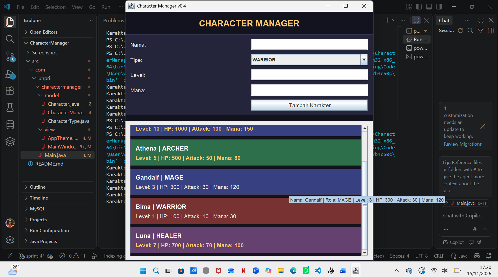

# TP10 — Character Manager Sprint #4
## Theming, Properti Komponen & Analisis MVC

### A. Implementasi Tema

Pada TP10, aplikasi Character Manager dikembangkan menggunakan sistem tema terpusat melalui kelas `AppTheme.java`.

`AppTheme` digunakan untuk mengatur warna, font, border, dan warna kartu berdasarkan role karakter. Dengan demikian, pengaturan tampilan tidak perlu ditulis berulang kali di `MainWindow.java`.

Implementasi yang dibuat meliputi:
- Warna latar utama aplikasi.
- Warna kartu karakter berdasarkan role.
- Font judul, subtitle, dan isi.
- Border kartu karakter.
- Method `colorFor()` untuk menentukan warna berdasarkan tipe karakter.
- `pack()` untuk menyesuaikan ukuran jendela.

### B. Mini-Challenge

Karakter dengan level minimal 5 ditampilkan menggunakan teks berwarna emas dan tebal.

Batas level disimpan dalam konstanta:

`LEVEL_HIGHLIGHT = 5`

Dengan menggunakan konstanta, batas level dapat diubah tanpa mencari angka yang ditulis berulang kali di dalam kode.

### C. Enam Data Karakter

| Nama | Role | Level |
|---|---|---:|
| Arjun | WARRIOR | 8 |
| Merlin | MAGE | 10 |
| Athena | ARCHER | 5 |
| Gandalf | MAGE | 3 |
| Bima | WARRIOR | 1 |
| Luna | HEALER | 7 |

### D. Properti Tambahan

1. **Tooltip**  
   Tooltip menampilkan informasi karakter seperti nama, role, level, HP, attack, dan mana. Properti ini membantu pengguna melihat detail karakter.

2. **setEnabled()**  
   Kartu karakter level 1 diberi status tidak aktif. Tujuannya untuk membedakan karakter yang masih berada pada level awal.

### E. Screenshot

**Tampilan Sebelum — TP8**

Simpan screenshot dengan nama:

**Tampilan Sesudah — TP10**

Simpan screenshot dengan nama:

### F. Analisis MVC

Warna dan font disimpan di `AppTheme`, bukan di kelas `Character`, karena warna dan font merupakan bagian dari tampilan aplikasi. Kelas `Character` bertugas menyimpan data karakter, sedangkan `MainWindow` bertugas menampilkan data tersebut. Pemisahan ini membuat program lebih terstruktur dan memudahkan perubahan tampilan tanpa mengubah model.

### G. Google Docs

Dokumen analisis TP10:

**[https://1drv.ms/w/c/EF681E4F4E3CE288/IQAcJDuXdPxjT77TTgSWo8igAfhssUIipbQZ7LZ3LbLqbpE?e=YWeevu]**