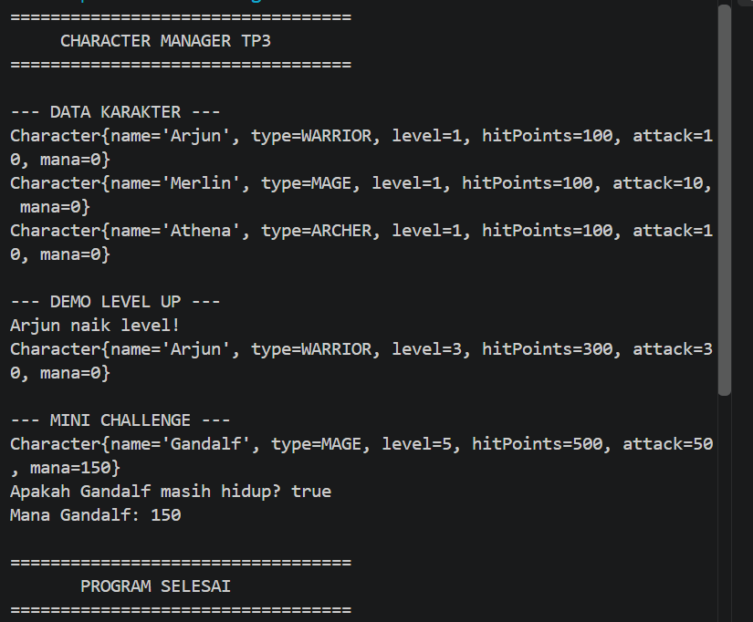

# Character Manager — TP3 (Java Visual SIH-6406)

## 1. Deskripsi Project

Character Manager merupakan aplikasi sederhana berbasis Java yang dikembangkan untuk memenuhi tugas TP3 (AP3 Belajar Praktik) mata kuliah Java Visual SIH-6406.

Project ini menerapkan konsep dasar Object-Oriented Programming (OOP), meliputi Class, Object, Attribute, Constructor, Method, dan Encapsulation. Program digunakan untuk membuat, mengatur, serta menampilkan informasi karakter berdasarkan tipe dan atribut yang dimiliki.

## 2. Fitur Program

Fitur yang telah dikembangkan dalam TP3:

- Membuat class `Character` sebagai representasi objek karakter.
- Menggunakan enum `CharacterType` untuk menentukan jenis karakter.
- Membuat objek menggunakan dua constructor.
- Mengatur atribut karakter seperti nama, level, hit points, attack, dan mana.
- Menggunakan getter dan setter untuk mengakses atribut.
- Menerapkan validasi pada atribut mana.
- Menggunakan method `toString()` untuk menampilkan informasi karakter.
- Menggunakan method `isAlive()` untuk mengetahui apakah karakter masih hidup berdasarkan hit points.
- Menampilkan tiga karakter dan demonstrasi level up melalui terminal.

## 3. Screenshot Hasil Program

Berikut merupakan dokumentasi hasil pengujian program Character Manager TP3 melalui terminal Visual Studio Code.

### Output Terminal



Screenshot tersebut memperlihatkan hasil program ketika dijalankan, termasuk informasi karakter, demonstrasi level up, dan hasil pengujian method `isAlive()`.

## 4. Struktur Folder Project

Berikut adalah struktur folder project Character Manager:

```text
CharacterManager/
│
├── src/
│   └── com/
│       └── unpri/
│           └── charactermanager/
│               ├── Main.java
│               │
│               └── model/
│                   ├── Character.java
│                   └── CharacterType.java
│
├── Screenshot/
│   └── output_tp3.png
│
└── README.md
```

## 5. Teknologi yang Digunakan

| Teknologi | Keterangan |
|---|---|
| Java JDK 17 | Bahasa pemrograman dan development kit |
| Visual Studio Code | Code editor |
| Git | Version control |
| GitHub | Penyimpanan repository |

## 6. Identitas Mahasiswa

| Keterangan | Informasi |
|---|---|
| Nama | Purnama Sari |
| NIM | 253303621208 |
| Mata Kuliah | Java Visual SIH-6406 |
| Tugas | TP3 – Character Manager Sprint #1 |

## 7. Link Dokumentasi Google Docs

Dokumentasi analisis desain dan ekosistem Java untuk memenuhi Bagian D tugas TP3 dapat diakses melalui tautan berikut:

**Google Docs:** [https://1drv.ms/w/c/EF681E4F4E3CE288/IQAz1p2p37D5Q5d16b9GdislAadJElEDL_bpfsny-L73cIs?e=xOdoln]

## 8. Kesimpulan

Melalui tugas TP3 Character Manager, saya mempelajari penerapan konsep dasar Object-Oriented Programming menggunakan bahasa Java. Saya memahami cara membuat class, object, constructor, attribute, dan method untuk membangun program pengelolaan karakter sederhana.

Selain itu, saya juga mempelajari penerapan encapsulation, penggunaan enum, validasi data, serta pengembangan method tambahan seperti `isAlive()`.

Project ini menjadi dasar pengembangan Character Manager pada sprint berikutnya.