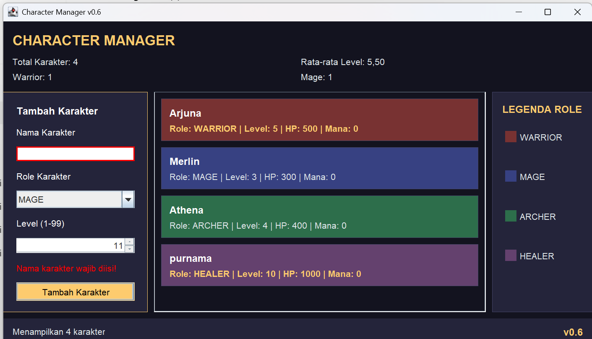

# TP14 — Character Manager Sprint #6
## Form Input, Validasi & Analisis MVC

**Mata Kuliah:** Java Visual  
**Versi Aplikasi:** v0.6  
**Branch:** `sprint-6-input`  
**Nama:** Purnama Sari  
**NIM:** 253303621208

### A. Deskripsi Sprint

Pada Sprint 6, aplikasi Character Manager dikembangkan dengan menambahkan fitur formulir input karakter. Pengguna dapat menambahkan karakter baru melalui formulir yang terdiri dari JTextField untuk nama, JComboBox untuk memilih role, dan JSpinner untuk menentukan level karakter.

Validasi dilakukan pada dua lapisan, yaitu View dan Model. Tujuannya adalah memastikan data yang dimasukkan pengguna sesuai dengan aturan aplikasi sebelum disimpan ke dalam CharacterManager.

### B. Fitur yang Dikembangkan

1. Form input nama karakter.
2. Pilihan role WARRIOR, MAGE, ARCHER, dan HEALER.
3. Input level menggunakan JSpinner dengan rentang 1–99.
4. Validasi nama kosong.
5. Validasi panjang nama 3–20 karakter.
6. Validasi format nama yang hanya menerima huruf dan spasi.
7. Validasi nama duplikat tanpa membedakan huruf besar dan kecil.
8. Validasi Model untuk MAGE dengan level maksimal 60.
9. Karakter baru langsung ditampilkan pada daftar setelah berhasil ditambahkan.

### C. Screenshot Pengujian

**1. Error Nama Kosong**

Ketika pengguna menekan tombol tambah tanpa mengisi nama karakter, aplikasi menampilkan pesan kesalahan dan memberikan tanda merah pada kolom nama.

**2. Error Nama Duplikat**

Ketika pengguna memasukkan nama karakter yang sudah digunakan, aplikasi menolak penambahan karakter tersebut.

Contoh: nama `purnama` ditolak karena karakter `purnama` sudah tersedia.

**3. Berhasil Menambahkan Karakter**

Ketika pengguna memasukkan data yang valid, karakter berhasil ditambahkan dan langsung muncul pada daftar karakter.

Contoh: karyn dengan role MAGE dan level 15.

### D. Tabel Pengujian Validasi

| No. | Input Pengujian | Hasil yang Diharapkan | Hasil Aktual |
|---|---|---|---|
| 1 | Nama kosong | Ditolak, muncul pesan nama wajib diisi | Isi setelah pengujian |
| 2 | Nama hanya spasi | Ditolak karena nama kosong setelah trim() | Isi setelah pengujian |
| 3 | Nama Ab | Ditolak karena kurang dari 3 karakter | Isi setelah pengujian |
| 4 | Nama Arjuna123 | Ditolak karena mengandung angka | Isi setelah pengujian |
| 5 | Nama arjuna | Ditolak karena nama sudah digunakan | Isi setelah pengujian |
| 6 | Bima, MAGE, level 8 | Berhasil ditambahkan dan kartu muncul | Isi setelah pengujian |
| 7 | Nama dengan 21 karakter | Ditolak karena melebihi 20 karakter | Isi setelah pengujian |
| 8 | Nama Bima Sakti | Berhasil ditambahkan | Isi setelah pengujian |
| 9 | MAGE dengan level 500 melalui Model | Ditolak karena MAGE maksimal level 60 | Isi setelah pengujian |

**Catatan pengujian:**

Jika hasil aktual berbeda dari hasil yang diharapkan, jelaskan perbedaannya dan tindakan perbaikan yang dilakukan. Pengujian dilakukan untuk memastikan validasi View dan Model bekerja sesuai aturan.

### E. Analisis Validasi MVC

Validasi pada aplikasi Character Manager dibagi menjadi dua lapisan.

**1. Validasi View**

Validasi View dilakukan pada `CharacterFormPanel.java`. Pemeriksaan meliputi nama kosong, panjang nama, format nama, dan nama duplikat. Pesan kesalahan ditampilkan langsung pada formulir agar pengguna mengetahui kesalahan input.

**2. Validasi Model**

Validasi Model dilakukan pada `Character.java`. Model memastikan nama tidak kosong, role tidak null, level berada pada rentang 1–99, dan MAGE tidak memiliki level lebih dari 60.

Jika data melanggar aturan Model, aplikasi menghasilkan `IllegalArgumentException` dengan pesan yang menjelaskan kesalahan.

### F. Kompromi Sementara

Pada Sprint 6, tombol tambah karakter masih menggunakan ActionListener dengan lambda sederhana untuk menangani tindakan pengguna. Selain itu, CharacterFormPanel masih memanggil CharacterManager secara langsung ketika menyimpan karakter. Kedua pendekatan tersebut merupakan kompromi sementara agar fokus pengembangan berada pada proses input dan validasi. Pada pertemuan berikutnya, pemanggilan tersebut direncanakan dipindahkan ke Controller agar penerapan pola MVC menjadi lebih terstruktur.

### G. Google Docs Analisis AP19

Dokumen analisis Bagian D:

**Link Google Docs:**  
[https://1drv.ms/w/c/EF681E4F4E3CE288/IQD-9nyL6eZ4RaZcm4upHH8_ATBvyoi1Q2EJA3cFzYe18hI?e=UYjmE8]

### H. Kesimpulan

Pada Sprint 6, aplikasi Character Manager telah dikembangkan dengan fitur formulir input dan validasi data. Pengguna dapat menambahkan karakter baru melalui formulir, sedangkan validasi View dan Model memastikan data yang dimasukkan sesuai dengan aturan aplikasi.

Pengembangan ini menjadi dasar untuk penerapan pola MVC yang lebih terstruktur pada sprint berikutnya.