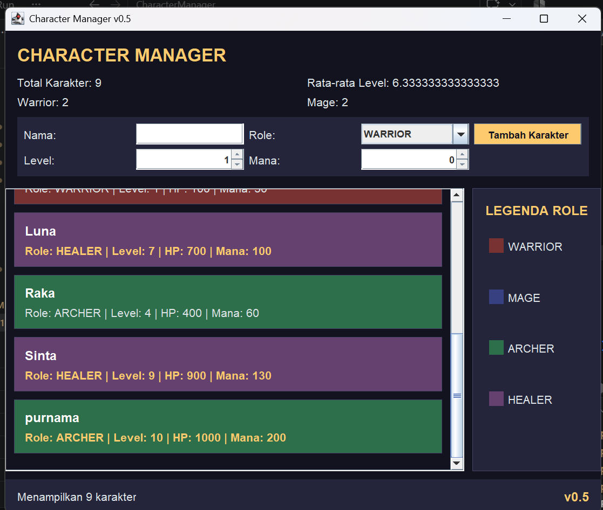
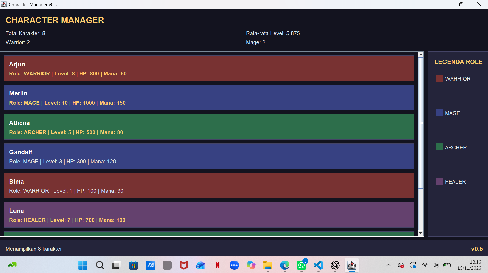
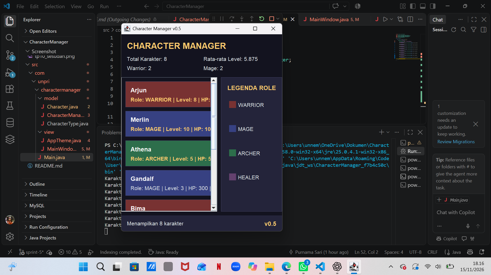

# TP12 — Character Manager Sprint #5
## Layout, UI Responsif & Analisis MVC

**Mata Kuliah:** Java Visual  
**Kode Mata Kuliah:** SIH-6406  
**Nama:** Purnama Sari  
**NIM:** 253303621208  
**CPMK:** 2  
**SCPMK:** 5  
**Versi Aplikasi:** v0.5

---

## 1. Deskripsi Tugas

TP12 merupakan pengembangan dari Character Manager Sprint #4 (TP10). Pada sprint ini, aplikasi dikembangkan dengan fokus pada pengaturan layout, tampilan responsif, penggunaan Layout Manager, dan penerapan konsep Model-View-Controller (MVC).

Aplikasi menggunakan Java Swing dengan beberapa Layout Manager, yaitu BorderLayout, GridLayout, BoxLayout, dan FlowLayout. Selain itu, JScrollPane digunakan agar daftar karakter tetap dapat diakses ketika ukuran jendela diperkecil.

## 2. Tujuan Pengerjaan

Tujuan pengerjaan TP12 adalah:

1. Mengimplementasikan empat wilayah BorderLayout.
2. Menampilkan daftar karakter menggunakan JScrollPane.
3. Membuat legenda role secara dinamis menggunakan CharacterType.values().
4. Menambahkan panel statistik menggunakan GridLayout 2x2.
5. Membuat status bar dengan informasi di kiri dan versi aplikasi di kanan.
6. Menguji responsivitas tampilan ketika ukuran jendela berubah.
7. Memahami pemisahan Model dan View dalam konsep MVC.

## 3. Struktur Project

```text
CharacterManager/
│
├── Screenshot/
│   ├── tp12_ukuran_awal.png
│   ├── tp12_ukuran_lebar.png
│   └── tp12_ukuran_kecil.png
│
└── src/
    ├── README.md
    │
    └── com/
        └── unpri/
            └── charactermanager/
                │
                ├── Main.java
                │
                ├── model/
                │   ├── Character.java
                │   ├── CharacterManager.java
                │   └── CharacterType.java
                │
                └── view/
                    ├── AppTheme.java
                    └── MainWindow.java
```

## 4. Implementasi Layout

### A. BorderLayout

MainWindow menggunakan BorderLayout sebagai layout utama dengan empat wilayah:

| Wilayah | Komponen | Fungsi |
|---|---|---|
| NORTH | Header dan statistik | Menampilkan judul dan informasi karakter |
| CENTER | JScrollPane | Menampilkan daftar karakter |
| EAST | Panel legenda | Menampilkan warna setiap role |
| SOUTH | Status bar | Menampilkan informasi aplikasi dan versi |

### B. JScrollPane dan Panel Pembungkus

Daftar karakter ditampilkan menggunakan JPanel dengan BoxLayout Y_AXIS. Panel daftar karakter ditempatkan pada posisi NORTH sebuah JPanel pembungkus sebelum dimasukkan ke JScrollPane.

Penggunaan JScrollPane memungkinkan pengguna menggulir daftar karakter ketika jumlah karakter melebihi ruang yang tersedia.

### C. BoxLayout

BoxLayout digunakan untuk menyusun kartu karakter secara vertikal. Layout ini juga digunakan pada legenda agar setiap role tersusun dari atas ke bawah.

### D. GridLayout

Panel statistik menggunakan GridLayout dengan 2 baris dan 2 kolom untuk menampilkan:

- Total karakter.
- Rata-rata level.
- Jumlah Warrior.
- Jumlah Mage.

### E. Status Bar

Status bar menggunakan BorderLayout. Informasi jumlah karakter ditampilkan di sebelah kiri, sedangkan versi aplikasi v0.5 ditampilkan di sebelah kanan.

## 5. Wireframe Tampilan

Berikut gambaran susunan antarmuka Character Manager v0.5:

```text
+-------------------------------------------------------+
|                    HEADER (NORTH)                     |
|                 CHARACTER MANAGER                     |
|                                                       |
| Total Karakter       Rata-rata Level                  |
| Warrior              Mage                             |
+--------------------------------------+----------------+
|                                      |                |
|             CENTER                   |      EAST      |
|                                      |                |
|       +----------------------+       |  LEGENDA ROLE  |
|       | Kartu Karakter 1     |       |                |
|       +----------------------+       |  WARRIOR       |
|       | Kartu Karakter 2     |       |  MAGE          |
|       +----------------------+       |  ARCHER        |
|       | Kartu Karakter 3     |       |  HEALER        |
|       +----------------------+       |                |
|                                      |                |
|             SCROLLPANE               |                |
+--------------------------------------+----------------+
| Status Aplikasi                  v0.5                 |
+-------------------------------------------------------+
```

## 6. Screenshot Pengujian Responsivitas

### A. Ukuran Awal

Screenshot tampilan aplikasi pada ukuran jendela awal.



### B. Jendela Diperlebar

Screenshot ketika jendela diperlebar untuk melihat penyesuaian komponen.



### C. Jendela Diperkecil

Screenshot ketika jendela diperkecil hingga scrollbar terlihat dan daftar karakter tetap dapat digulir.



## 7. Tabel Pengamatan Resize

| Kondisi | Prediksi | Hasil Pengamatan |
|---|---|---|
| Ukuran awal | Semua komponen terlihat sesuai pembagian layout | Header, daftar karakter, legenda, dan status bar terlihat |
| Jendela diperlebar | Area CENTER menyesuaikan ruang yang tersedia | Daftar karakter mendapatkan ruang lebih lebar |
| Jendela diperkecil | Daftar karakter menggunakan scrollbar jika ruang tidak mencukupi | Scrollbar vertikal muncul dan daftar tetap dapat digulir |

## 8. Penjelasan Struktur Panel Bersarang

Aplikasi Character Manager menggunakan BorderLayout sebagai layout utama yang membagi tampilan menjadi beberapa wilayah. Pada bagian NORTH terdapat panel header yang berisi judul aplikasi dan panel statistik dengan GridLayout 2x2. Pada bagian CENTER terdapat JScrollPane yang membungkus panel daftar karakter dengan BoxLayout Y_AXIS, sedangkan bagian EAST berisi panel legenda dengan BoxLayout Y_AXIS. Bagian SOUTH digunakan sebagai status bar dengan BorderLayout untuk memisahkan informasi status dan versi aplikasi.

## 9. Alasan Pemilihan Layout dan Layout yang Ditolak

Saya memilih GridLayout untuk panel statistik karena empat informasi statistik perlu disusun secara teratur dalam dua baris dan dua kolom. BoxLayout dipilih untuk daftar karakter dan legenda karena komponennya lebih sesuai disusun secara vertikal.

Saya tidak memilih GridLayout untuk daftar karakter karena setiap kartu akan dipaksa menempati sel dengan ukuran yang sama. Saya juga tidak menggunakan setLayout(null) karena posisi komponen harus diatur secara manual dan dapat menyebabkan tampilan tidak responsif ketika ukuran jendela berubah.

## 10. Pengembangan Karakter

Pada TP12, aplikasi menampilkan minimal delapan karakter dengan variasi level dan role.

| No. | Nama | Role | Level |
|---|---|---|---:|
| 1 | Arjun | WARRIOR | 8 |
| 2 | Merlin | MAGE | 10 |
| 3 | Athena | ARCHER | 5 |
| 4 | Gandalf | MAGE | 3 |
| 5 | Bima | WARRIOR | 1 |
| 6 | Luna | HEALER | 7 |
| 7 | Raka | ARCHER | 4 |
| 8 | Sinta | HEALER | 9 |

Karakter dengan level 5 atau lebih ditampilkan menggunakan warna emas dan font tebal agar lebih mudah dikenali.

## 11. Penerapan MVC

Pemisahan Model dan View tetap dipertahankan dalam pengembangan TP12.

- **Model:** Mengelola data karakter melalui Character, CharacterManager, dan CharacterType.
- **View:** Mengatur tampilan aplikasi melalui MainWindow dan AppTheme.
- **Main:** Menjalankan aplikasi dan menyiapkan data karakter.

Seluruh pengaturan layout berada pada package view sehingga perubahan tampilan tidak mengharuskan perubahan pada struktur data di package model.

## 12. Google Docs — Analisis Layout & MVC

Dokumen analisis TP12 membahas:

1. Masalah setLayout(null) dan setBounds().
2. Layout default JPanel dan JFrame.
3. Perilaku lima wilayah BorderLayout.
4. Perbandingan GridLayout dan BoxLayout.
5. Pemisahan Model dan View serta fungsi revalidate() dan repaint().

**Link Google Docs:**

[https://1drv.ms/w/c/EF681E4F4E3CE288/IQAirM9IlhlKT6YNBaRlGPqAAbtsAPXAaYEbE3iWuJAEMAY?e=GFv3dm]

## 13. Kesimpulan

Melalui pengerjaan TP12, saya memahami bahwa penggunaan Layout Manager sangat penting untuk membuat aplikasi Java Swing yang responsif dan terstruktur. Setiap Layout Manager memiliki fungsi yang berbeda sehingga pemilihannya perlu disesuaikan dengan kebutuhan tampilan.

Penggunaan BorderLayout, GridLayout, BoxLayout, dan JScrollPane membuat aplikasi Character Manager v0.5 lebih mudah digunakan ketika ukuran jendela berubah. Selain itu, pemisahan package Model dan View membantu menjaga struktur program agar lebih rapi dan mudah dikembangkan pada sprint berikutnya.