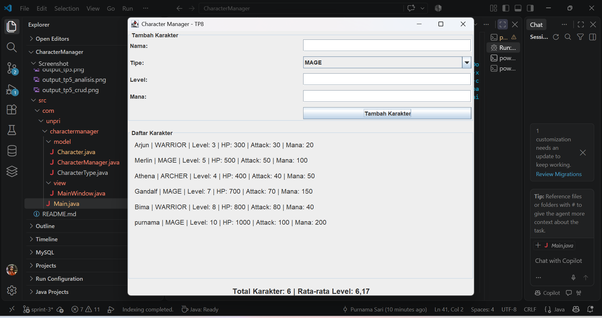

# CHARACTER MANAGER – TP8 (SPRINT 3)

## 1. Informasi Mahasiswa

- **Nama:** Purnama Sari
- **NIM:** 253303621208
- **Mata Kuliah:** Java Visual
- **Kode Mata Kuliah:** SIH-6406
- **Tugas:** TP8 – AP10
- **Sprint:** Sprint 3 – MainWindow, Data Dinamis & Analisis MVC

---

## 2. Deskripsi Proyek

Character Manager merupakan aplikasi berbasis Java yang digunakan untuk mengelola data karakter. Pada TP8 atau Sprint 3, aplikasi dikembangkan dari program berbasis console menjadi aplikasi berbasis Graphical User Interface (GUI) menggunakan Java Swing.

Aplikasi ini memungkinkan pengguna melihat daftar karakter, menambahkan karakter baru melalui formulir GUI, serta melihat statistik jumlah karakter dan rata-rata level secara otomatis.

Pengembangan ini juga menerapkan konsep Model-View-Controller (MVC) untuk memisahkan pengelolaan data dengan tampilan aplikasi.

## 3. Fitur Aplikasi

Fitur yang tersedia pada TP8:

1. Menampilkan daftar karakter secara dinamis.
2. Menambahkan karakter melalui formulir GUI.
3. Memilih tipe karakter melalui ComboBox.
4. Mengisi nama, level, dan mana karakter.
5. Menolak nama karakter yang sudah digunakan.
6. Melakukan validasi input.
7. Menampilkan total karakter.
8. Menghitung rata-rata level karakter secara otomatis.
9. Memperbarui tampilan setelah karakter berhasil ditambahkan.

## 4. Struktur Folder Proyek

```text
CharacterManager/
│
├── src/
│   └── com/
│       └── unpri/
│           └── charactermanager/
│               ├── Main.java
│               │
│               ├── model/
│               │   ├── Character.java
│               │   ├── CharacterType.java
│               │   └── CharacterManager.java
│               │
│               └── view/
│                   └── MainWindow.java
│
├── Screenshot/
│   ├── tp8_sebelum.png
│   └── tp8_sesudah.png
│
└── README.md
```

## 5. Data Karakter

Aplikasi memiliki lima karakter awal yang ditampilkan ketika program dijalankan:

| No. | Nama | Tipe | Level |
|---|---|---|---|
| 1 | Arjun | WARRIOR | 3 |
| 2 | Merlin | MAGE | 5 |
| 3 | Athena | ARCHER | 4 |
| 4 | Gandalf | MAGE | 7 |
| 5 | Bima | WARRIOR | 8 |

Pengguna juga dapat menambahkan karakter baru secara langsung melalui formulir pada jendela aplikasi.

## 6. Penerapan Konsep MVC

Aplikasi menggunakan konsep Model-View-Controller (MVC).

- **Model:** terdiri dari Character, CharacterType, dan CharacterManager yang bertugas menyimpan serta mengelola data karakter.
- **View:** MainWindow.java bertugas menampilkan data karakter dan menyediakan formulir untuk memasukkan karakter baru.
- **Alur data:** Main.java membuat objek CharacterManager dan memasukkan data awal, kemudian MainWindow menerima pengelola data tersebut untuk menampilkan karakter.

Dengan pemisahan ini, pengelolaan data dan tampilan aplikasi menjadi lebih terstruktur.

## 7. Alur Penggunaan Aplikasi

1. Program dijalankan melalui Main.java.
2. CharacterManager dibuat dan diisi dengan lima karakter awal.
3. MainWindow menampilkan jendela aplikasi.
4. Pengguna mengisi nama, tipe, level, dan mana karakter.
5. Pengguna menekan tombol Tambah Karakter.
6. Program memvalidasi data yang dimasukkan.
7. Jika berhasil, karakter ditambahkan dan daftar diperbarui.
8. Total karakter dan rata-rata level dihitung kembali.

## 8. Screenshot Hasil Program

### Sebelum Menambahkan Karakter

Menampilkan lima karakter awal beserta statistik rata-rata level.


### Sesudah Menambahkan Karakter

Menampilkan karakter tambahan yang dimasukkan melalui GUI serta perubahan statistik rata-rata level.



## 9. Dokumentasi Google Docs

**Link Google Docs Analisis TP8:**

[https://1drv.ms/w/c/EF681E4F4E3CE288/IQCVjYgbhaBeRrGWPrY4-RD8ASXF7lKziWi85TCA0ig1Hl8?e=bMIEth]

Dokumen berisi penjelasan mengenai konsep sequential dan event-driven programming, SwingUtilities.invokeLater(), inheritance, composition, serta penerapan konsep MVC pada aplikasi Character Manager.

## 10. Kesimpulan

Melalui TP8 Sprint 3, aplikasi Character Manager berhasil dikembangkan menjadi aplikasi GUI menggunakan Java Swing. Pengguna dapat melihat dan menambahkan data karakter secara langsung melalui jendela aplikasi. Selain itu, penerapan konsep MVC membantu memisahkan pengelolaan data dan tampilan sehingga program lebih terstruktur dan mudah dikembangkan.