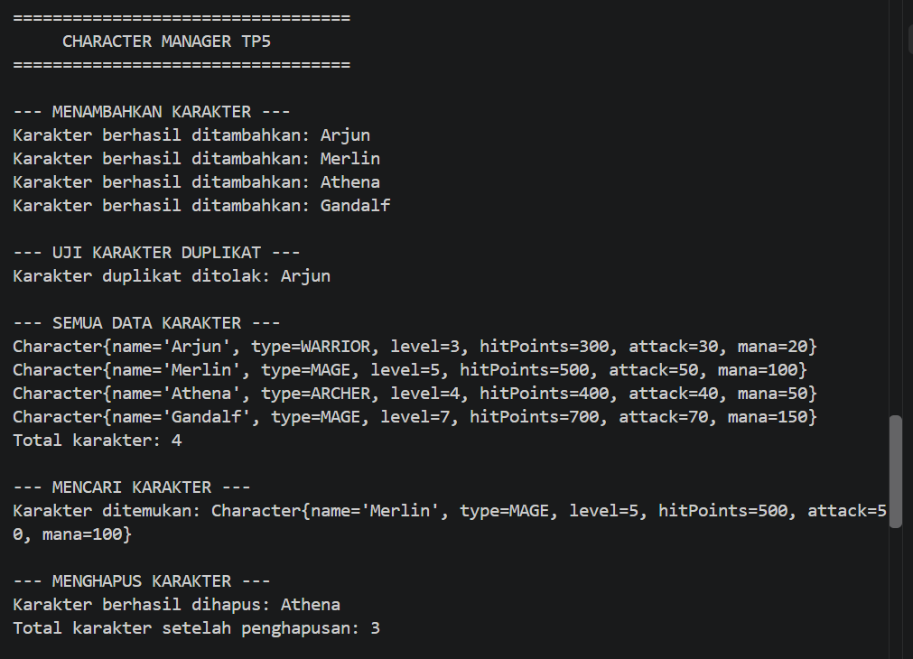

# TP5 – Character Manager Sprint #2

## CharacterManager, Analytics & Object Reference

### Deskripsi
Pada TP5, proyek Character Manager dikembangkan dengan menambahkan kelas CharacterManager untuk mengelola data karakter. Program dilengkapi fitur penambahan, pencarian, penghapusan, dan perhitungan jumlah karakter.

Selain itu, program menerapkan konsep Object Reference, penggunaan ArrayList, serta analisis data karakter.

### Fitur yang Dikembangkan
1. `addCharacter()` – Menambahkan karakter dan menolak nama duplikat.
2. `findByName()` – Mencari karakter berdasarkan nama.
3. `removeCharacter()` – Menghapus karakter.
4. `getTotalCharacters()` – Menghitung jumlah karakter.
5. `getAllCharacters()` – Mengembalikan salinan daftar karakter.
6. `getAverageLevel()` – Menghitung rata-rata level karakter.
7. `findByType()` – Mencari karakter berdasarkan jenis.
8. `findStrongest()` – Mencari karakter dengan attack tertinggi.
9. `equals()` – Membandingkan karakter berdasarkan nama.

### Pengujian Program
Program diuji melalui beberapa percobaan:
- Penambahan karakter.
- Penolakan karakter duplikat.
- Pencarian dan penghapusan karakter.
- Perhitungan rata-rata level.
- Pencarian berdasarkan tipe karakter.
- Pencarian karakter terkuat.
- Pengujian salinan ArrayList.
- Pengujian Object Reference.

### Screenshot Hasil Program

**1. Pengujian CRUD dan Duplikat**

**2. Pengujian Analisis Karakter**

### Identitas
- Nama: Purnama Sari
- NIM: 253303621208
- Mata Kuliah: Java Visual
- Tugas: TP5 / AP6
- Sprint: 2

### Link Google Docs

Dokumentasi analisis TP5 yang berisi pembahasan Object Reference, Primitive vs Reference, Static Variable, penggunaan equals(), dan Encapsulation.

Google Docs: [https://1drv.ms/w/c/EF681E4F4E3CE288/IQA4FnerNc4XQYRnqw-o7hjPAQjro83O_OJ4Mw9Ll9GR_IA?e=xlnIAI]

### Analisis Metode Tambahan
Metode `findStrongest()` digunakan untuk mencari karakter dengan nilai attack tertinggi. Metode ini membantu mengetahui karakter yang memiliki kekuatan serangan paling besar tanpa memberikan akses langsung ke ArrayList internal milik CharacterManager.

### Kesimpulan
Melalui TP5, proyek Character Manager memiliki kemampuan pengelolaan data yang lebih lengkap. Saya juga memahami konsep encapsulation, object reference, static, equals(), dan penggunaan ArrayList dalam Java.

